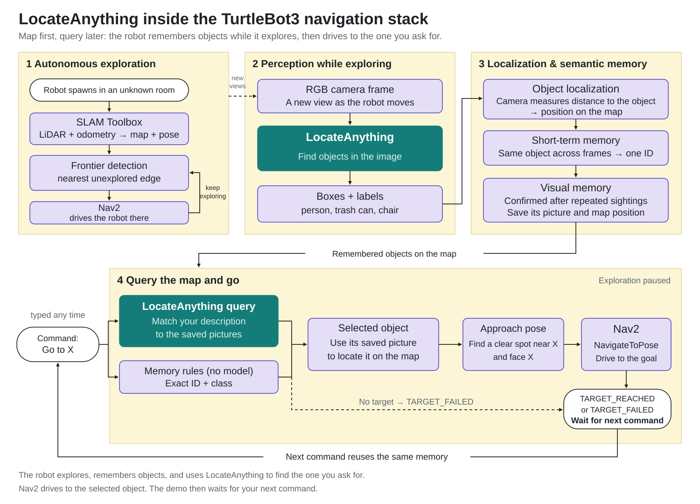
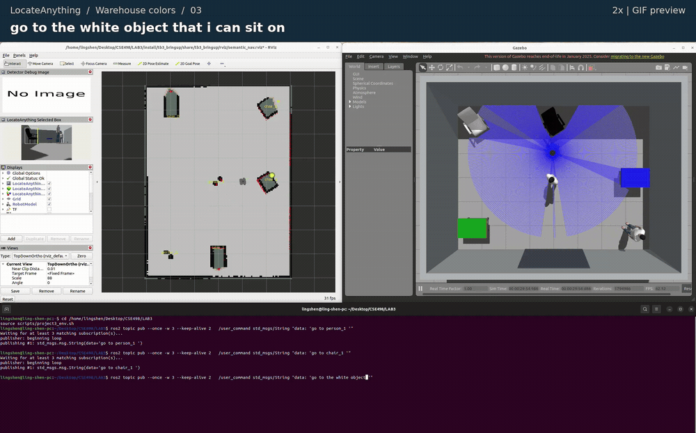
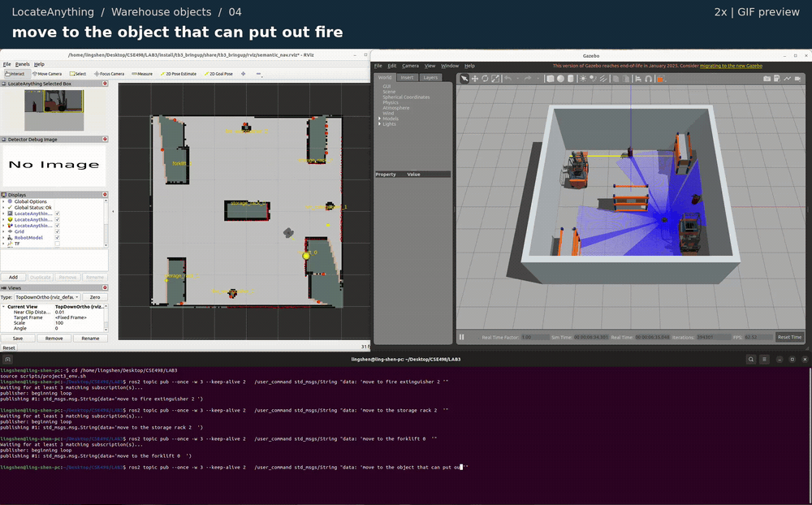

# LocateAnything Semantic Navigation — Project 3

A TurtleBot3 explores a room, builds a map, and remembers the objects it sees.
You then give it a command, and it navigates to a remembered object.
This project builds on [Yiyuchen Hu's ROS 2 course workspace](https://github.com/YiyuchenHu/turtlebot3-gazebo-navigation-hw).

LocateAnything recognizes objects in camera images and remembers their pictures
and positions on the map. Commands
can name an object, describe its color or purpose, or refer to a remembered ID.

**Map first, query later:** let the robot observe the room before asking it to
visit an object. A command selects from remembered objects; it does not guarantee
that an unseen object will be found.

## LocateAnything workflow



The diagram shows the default setup: a depth camera locates objects;
LiDAR is used for mapping and navigation.

Adapted from the [original course diagram](https://github.com/YiyuchenHu/turtlebot3-gazebo-navigation-hw/blob/main/docs/media/system_overview.svg).
[Full-resolution PNG](docs/media/locateanything_overview.png).

## Demos

Two recorded scenes, **15 queries**. Each GIF plays at **2x speed**; the linked
MP4 keeps the original speed. [Watch all 15 query clips](docs/media/demos/README.md).



**Color and purpose:** `go to the white object that i can sit on` selects the white
chair, `chair_0`. [Original-speed MP4](docs/media/demos/colors-03-white-seat.mp4)
· [All 6 color-scene queries](docs/media/demos/README.md#warehouse-colors).



**Purpose:** `move to the object that can put out fire` selects
`fire_extinguisher_1`. [Original-speed MP4](docs/media/demos/objects-04-put-out-fire.mp4)
· [All 9 warehouse queries](docs/media/demos/README.md#warehouse-objects), including
ID lookup, “another,” “farthest,” and the cargo-query mismatch.

<a id="setup-by-platform"></a>

## Setup and build

Use **Ubuntu 22.04, ROS 2 Humble, and Gazebo Classic 11**. LocateAnything also
needs its external model, Python environment, Eagle source, and a CUDA GPU.
The model files are kept outside this repository.

<details>
<summary>First-time setup on another machine</summary>

After installing ROS 2 Humble, install the simulation and navigation dependencies:

```bash
sudo apt install ros-humble-desktop ros-humble-gazebo-ros-pkgs \
  ros-humble-turtlebot3-gazebo ros-humble-navigation2 ros-humble-nav2-bringup \
  ros-humble-slam-toolbox ros-humble-vision-msgs ros-humble-cv-bridge \
  ros-humble-tf2-geometry-msgs ros-humble-nav2-regulated-pure-pursuit-controller \
  python3-colcon-common-extensions python3-numpy python3-yaml nlohmann-json3-dev
git clone https://github.com/lllingshen/project3a.git ~/project3a
```

For LocateAnything, set the paths to your existing installation **before**
sourcing the environment helper:

```bash
export LOCATEANYTHING_PYTHON=/path/to/model-environment/bin/python
export LOCATEANYTHING_MODEL=/path/to/LocateAnything-3B
export LOCATEANYTHING_EAGLE=/path/to/Eagle
```

Setting paths does not install the model or its dependencies. Use a working
LocateAnything-3B environment with the compatible Eagle code. The ROS nodes
use system Python; model inference runs in the configured worker environment.

</details>

Build from the repository root; replace `~/project3a` with your checkout path.

```bash
cd ~/project3a
env -u PYTHONPATH -u AMENT_PREFIX_PATH -u CMAKE_PREFIX_PATH -u COLCON_PREFIX_PATH \
  PATH=/usr/bin:/bin bash --noprofile --norc -c \
  'source /opt/ros/humble/setup.bash; colcon build --symlink-install --executor sequential'
```

This builds with ROS's system Python. Keep `--symlink-install` on later builds.

<a id="running"></a>

## Prepare every terminal

Before starting, execute this in **each terminal**:

```bash
cd ~/project3a
source scripts/project3_env.sh
```

The helper loads ROS, the built packages, and the local model environment.
Run one simulation at a time. Stop the running launch with `Ctrl+C` before
switching scenes; a fresh launch rebuilds the map and object memory.

## Run LocateAnything

Use **two terminals**.

**Terminal A — start a scene:**

```bash
ros2 launch tb3_bringup locateanything_demo.launch.py scenario:=chairs
```

Choose a scene by changing `scenario`:

| Scene | Objects | Commands to try |
|---|---|---|
| `chairs` | One red chair and one blue chair | `go to the red chair`, `go to the blue chair` |
| `warehouse_objects` | Two forklifts, three fire extinguishers, three storage racks | `go to a random forklift`, `go to a fire extinguisher` |
| `warehouse_colors` | Two people, green/blue tables, white/black chairs | `go to the green table`, `go to the white chair` |

The robot starts from a random safe pose and begins exploring when navigation
is ready. There is no fixed startup countdown or mandatory initial spin.
Let it explore until the target appears in its confirmed memory:

```bash
ros2 topic echo --once /locateanything/memory --qos-durability transient_local
```

**Terminal B — send a command:**

```bash
ros2 topic pub --once /user_command std_msgs/String "data: 'go to the red chair'"
```

Replace the text inside the single quotes to try another command. You can also
use a confirmed ID shown in memory, such as `go to chair_0`. IDs depend on the
current run; `chair_0` does not always mean the red chair.

**Wait for `TARGET_REACHED` or `TARGET_FAILED` before sending the next command.**
Watch status in terminal A, or use this in terminal B and press `Ctrl+C` when
you want to type another command:

```bash
ros2 topic echo /coordinator_node/status
```

After a command succeeds or fails, this demo stays stopped and accepts the next
command. Add `auto_resume_exploration:=true` to the launch command if you want
it to continue exploring afterward. Add `spawn_seed:=498` to repeat a starting
pose with the same scene.

Start with explicit colors and object names. Descriptions such as
`go to the red object I can sit on` also go to the model, but purpose and spatial
relations can be misunderstood. **Reaching a target does not prove that the
correct object was selected.**

## Repository layout

| Package | Role |
|---|---|
| `tb3_bringup` | Launch files, scenes, robot setup, and RViz configuration |
| `tb3_locateanything` | LocateAnything inference, visual memory, RGB-D localization, and target selection |
| `tb3_interfaces` | Target-selection message shared by perception and navigation |
| `tb3_coordinator` | Pause exploration, dispatch navigation, and report command status |
| `tb3_nav_adapter` | Choose a safe position near the selected object |
| `tb3_frontier_exploration` | Explore unmapped parts of the room |

## More

- **LocateAnything details and warehouse examples:** [warehouse guide](docs/warehouse_examples.md).
- **Troubleshooting:** [troubleshooting](docs/troubleshooting.md).
- **Earlier project report and measurements:** [report](report/report.pdf),
  [initial results](report/results.json), [visual-memory results](report/visual_memory_results.json),
  and [warehouse results](report/warehouse_results.json).

The report and saved measurements describe earlier versions and conditions;
they do not validate every behavior of the current RGB-D pipeline.

## Credits and license

Based on [Yiyuchen Hu's course project](https://github.com/YiyuchenHu/turtlebot3-gazebo-navigation-hw).
Geometry helpers also draw on
[Ling Shen's earlier semantic-navigation work](https://github.com/lllingshen/turtlebot3-semantic-research).
Code is MIT-licensed; see [LICENSE](LICENSE). Third-party Gazebo models retain
their own licenses and attribution in [NOTICE](NOTICE).
