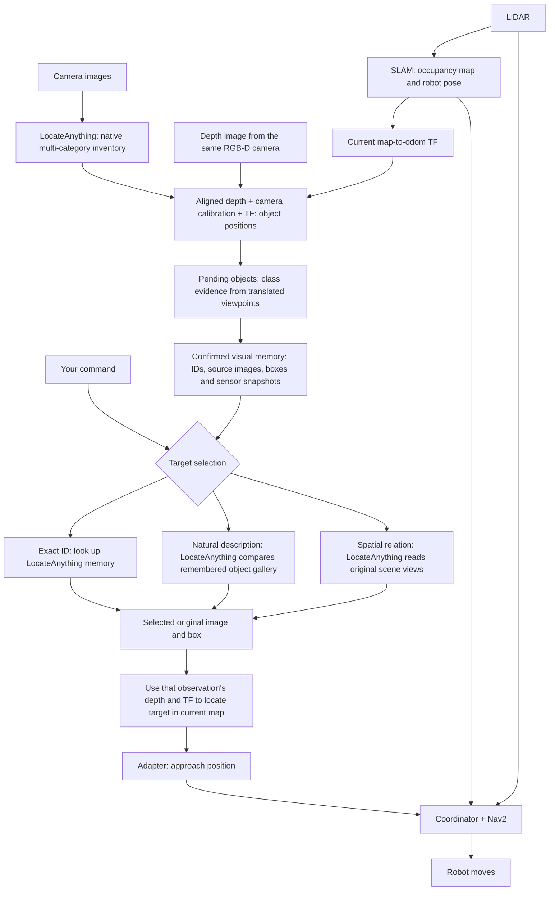

# TurtleBot3 Gazebo Navigation Course

## Project 3 — Ling Shen

This private assignment repository keeps the original YOLO coursework pipeline and
adds an independent LocateAnything perception, visual-memory, and navigation pipeline.
LocateAnything builds and queries its own object memory without running YOLO.
The demo now uses aligned RGB-D for object positions; LiDAR still supplies
SLAM and navigation. The recorded results linked below are from the earlier
RGB + 2-D LiDAR implementation, not validation of this RGB-D revision.
The original course instructions and reference demos remain below; their
measurements are not this project's results. See
[the English report](report/report.pdf), [LaTeX source](report/report.tex),
[two-chair memory results](report/visual_memory_results.json),
[warehouse results](report/warehouse_results.json), and
[earlier measured attempts](report/results.json).
The PDF describes the earlier RGB + 2-D LiDAR implementation; the current
architecture and memory settings below supersede its implementation description.

### Build and local environment

Validated on this machine: Ubuntu 22.04, ROS 2 Humble, Gazebo Classic 11,
Python 3.10, NumPy 1.26.4, Ultralytics 8.4.60, PyTorch 2.7.1+cu128,
and an RTX 5090. No global dependency changes are needed on this machine.
The shipped `tb3det_yolo26n.pt` and whitelist (`person`, `trash_can`, `chair`)
are retained for baseline compatibility. LocateAnything weights and the model
runtime are external; build outputs and raw runtime evidence stay outside Git.
The repository includes the Gazebo scene assets and selected result records;
their sources and licenses are recorded in [NOTICE](NOTICE).

```bash
cd /home/lingshen/Desktop/CSE498/LAB3
# Build with ROS's system Python, without the model environment's setuptools.
env -u PYTHONPATH -u AMENT_PREFIX_PATH -u CMAKE_PREFIX_PATH -u COLCON_PREFIX_PATH \
  PATH=/usr/bin:/bin bash --noprofile --norc -c \
  'source /opt/ros/humble/setup.bash; colcon build --symlink-install --executor sequential'
```

In **every runtime terminal**, first run:

```bash
cd /home/lingshen/Desktop/CSE498/LAB3
source scripts/project3_env.sh
```

The helper selects ROS domain **49**, localhost communication, and Gazebo port
**11349**. It adds the existing Python 3.10 model packages for the YOLO node;
LocateAnything runs in its own persistent subprocess with ROS Python paths removed.
These existing external resources are required:

```bash
export LOCATEANYTHING_PYTHON=/home/lingshen/miniforge3/envs/locateanything3b/bin/python
export LOCATEANYTHING_MODEL=/home/lingshen/research/locateanything_standalone/models/LocateAnything-3B
export LOCATEANYTHING_EAGLE=/home/lingshen/research/locateanything_standalone/Eagle
# Set overrides BEFORE sourcing scripts/project3_env.sh on another installation.
```

### Independent LocateAnything pipeline

`mode:=locateanything` does not start YOLO, the detector, the baseline localizer,
`semantic_memory_node`, `semantic_map_memory_node`, or `semantic_query_node`.
Those packages remain available for the original assignment. The two modes
share Gazebo, SLAM, TF, the navigation adapter, coordinator, and Nav2. SLAM
builds the occupancy map; LocateAnything supplies the object observations.
Initial object discovery, memory confirmation and later target queries all use
LocateAnything; this mode does not need a memory built by YOLO first.

The shared Nav2 configuration uses one Regulated Pure Pursuit (RPP) controller
for initial turning, path following, and final orientation. This avoids the
opposing turns observed when RotationShim handed a curved path to DWB. Its
desired forward speed is 0.22 m/s and in-place turning speed is 0.6 rad/s, with
speed reduction near obstacles, sharp turns, and the goal. Collision prediction
remains enabled. The launch generates a temporary parameter file, leaving
installed Nav2 defaults unchanged.

The navigation adapter checks the current global costmap before publishing a
parking goal. It prefers the original 0.5 m stand-off, searching reachable grid
cells within the explicit `max_approach_distance` of 1.0 m when that point is
occupied or too close to an obstacle. Unknown cells, disconnected regions and
endpoint costs above 60 are rejected; the chosen pose faces the selected object.
The robot pose uses the latest cached TF without waiting for an exact clock-tick
sample. A future latest sample is usable only if the cache can interpolate at
the current time; the same 0.75 s freshness limit, rollback checks and elapsed
search-time checks still apply. Missing or stale costmap/robot TF produces no
goal. NavFn's tolerance is 0.05 m,
so it cannot silently substitute a point up to 0.5 m away. These distances refer
to the measured target point, not the object's full outer surface.

The launch also inherits SLAM Toolbox's synchronous mapping configuration,
with a 0.10 m travel threshold, a 0.10 rad heading threshold, and a 1 s map
update interval. The default 0.50 m travel threshold could leave the map
unchanged after reaching a nearby frontier, preventing further exploration.
The default `slam_profile:=simulation_world_odom` keeps local scan matching but
disables loop closure. The course Gazebo diff-drive plugin already supplies
world-based odometry; repeated warehouse geometry caused false loop corrections
with that low-drift input. This profile adds no object coordinates or map truth.
`slam_profile:=default` retains upstream loop-closure settings for a separate
odometry configuration; it is not covered by the simulation validation here.
NavFn is configured to avoid unknown costmap cells; frontier goals still
require a connected, known-free approach.

If SLAM leaves an unknown cell under the robot, start connectivity may use a
temporary bridge inside the current Nav2 footprint. Each whole grid cell in
that bridge must be contained in the footprint and covered by free costmap
cells; occupied map cells remain blocked. The footprint is transformed using
its own timestamp and then the fresh current robot pose. Missing or stale
footprint evidence leaves the original refusal in place. Outside this bounded
start region, routes still require known-free map cells. This does not alter
SLAM data or make unknown cells eligible as navigation targets.

Both modes keep the public `/cmd_vel` interface. The simulator's
`velocity_relay` forwards the latest command unchanged at 20 Hz to
`/tb3_drive/cmd_vel`, where it is the only writer. It sends zero velocity after
0.5 seconds without a new command, clears the cached command when simulation
time rolls back, and sends zero before normal shutdown. The timeout uses wall
time, so it still works while simulation time is paused. Nav2 retains its
planning and collision checks.



While the robot explores, each retained image first gets a native LocateAnything
inventory request covering the configured categories together. Each configured
category without boxes in that answer gets one additional request using its
canonical name on the same image. This includes categories reported as `None`
or omitted from the joint answer. There is no further retry round: an image
uses at most one joint request plus one request per configured category. Raw
answers and inference times are retained, and all returned boxes are checked
together. A supplement does not force a detection or confirm an object's
identity. Returned labels stay paired with their boxes; an explicit `None`
applies only to that category, and omission is not evidence of absence.
Valid observations are
associated with physical tracks. In depth mode, a new track starts as a pending
`candidate_N`; it receives an ID such as `chair_0` only after class confirmation.
When the model is idle, snapshot capture is checked every 0.25 seconds, with a
15-degree viewpoint change threshold as well as a translation threshold.
Only one inventory image may be waiting or in progress. It is processed before
another image is admitted, so new captures cannot evict an unfinished image
from the 32-view pool. Queries have priority after the current inference ends
and share this admission limit. This timer is not a four-inferences-per-second
rate. Each retained view contains
the original RGB image, aligned depth, scan, calibration and observation-time
transforms. The demo defaults are `rgbd_camera:=true localization_mode:=depth`: one
Gazebo camera renders aligned RGB and measured depth with the same timestamp and
optical frame. Depth is not inferred by LocateAnything.

For a nonspatial description of color, appearance or purpose, remembered object crops are placed together
in a gallery so LocateAnything can compare them. Each valid model match maps back
to its **original image and box**; localization uses that source observation's
calibration, depth and TF, never the gallery's pixel coordinates. Commands about
spatial relations use representative original scene views to retain context.
Exact IDs use direct lookup by default (`enable_explicit_id_lookup=true`, a
LocateAnything node parameter). Both `go to forklift_1` and
`go to a forklift_1` select that ID; `a`, `an` and `the` are accepted.
All natural descriptions, including `go to a random forklift`, `go to any forklift`,
`go to a forklift` and `go to a random red chair`, go through LocateAnything with
all description words retained. For nonspatial requests starting with
`any`, `random`, `a` or `an`, the model first grounds matching objects; the program
then chooses randomly among the returned valid matches, counting each ID once.
This is not a class-keyword shortcut: `red` and other qualifiers still constrain
the model request. The model may return just one match, so this does not sample
uniformly from every object in the room. Repeated choices may select the same
ID: random does not mean another. Both model queries and ID lookup use Memory
built by LocateAnything, with no YOLO or simulator truth. Spatial relationships
continue to use complete scene images.
Other nonspatial descriptions may also produce several valid matches. The default
is to choose the nearest model-matched, confirmed and nonconflicted ID by current
robot-to-object straight-line XY distance. Object positions use a common current
`map <- odom` transform for this comparison. This does not search all of Memory
for the nearest object and does not estimate the shortest navigable path. Explicit
spatial or relational descriptions keep the original-scene query route; they do
not fall back to this nearest-match policy.
Every selected target still needs valid evidence and must pass localization
and Nav2 checks; selection does not guarantee reachability or navigation success.
The model can still match the wrong semantic target; navigation arrival alone
does not establish that the command was understood correctly.
The node parameter is a startup setting, not a launch argument.

Depth mode enables `Memory(confirm_classes=True)`. A class needs observations
from at least two camera positions separated by 0.25 m, and at least two more
independent votes than the next class: 2:0 or 3:1 qualifies; 2:1 does not.
Repeated frames and rotation in place do not add independent votes. Promotion
requires a new qualifying observation; deleting an old image cannot promote a
candidate. These are fixed confirmation rules, not extra ROS launch parameters.
Pending objects cannot be selected as the final target of a user command.
Every nonspatial description, including `go to the object that can store cargo`
and `go to the storage rack`, uses a gallery of confirmed, nonconflicted objects
with usable retained images. Pending, conflicted or unusable records are omitted
from that gallery rather than blocking the model request. This does not delete
them, confirm their class or make them selectable. LocateAnything must still
match the full description. Valid returned matches are deduplicated by ID;
ordinary nonspatial descriptions choose the nearest eligible match, while
any-instance requests choose randomly among eligible matches. No match still fails.
These matches cover eligible known Memory, not a verified inventory of the whole room.
Depth-mode spatial-relation queries retain their completeness checks: relevant
pending or conflicted tracks block selection. When the command does not identify
a category, this check covers all tracks; unrelated categories do not block a
query with an explicit category. Exact-ID lookup checks the requested instance
itself.

Memory is bounded to 32 viewpoints and 30 minutes by default. It lasts for the
current process/map session, clears on simulation-clock rollback, and is not a
map saved across restarts. Close duplicate views do not overwrite a useful wide
view; eviction favors keeping an instance's only retained image, independent
class-evidence viewpoints and complete-box sources. Votes are still calculated
from the actual retained images; eviction does not invent or preserve votes for
discarded pictures. Capacity remains 32 views, so this preference cannot keep
every observation. An ID is removed
when it has no remaining image evidence. Measured depth surface samples in
odom support association across viewpoints, while objects observed in separate
boxes in the same image are kept distinct. After depth-mode confirmation, one
contradictory class observation is retained for audit; another class supported
from two independent positions can mark the stable ID `conflicted` and block
navigation. When its confirmed class has support from a box that does not touch
an image edge, cropped competing boxes remain audit evidence but cannot alone
trigger a conflict. Equally complete competing observations still can. Initial
confirmation can use cropped observations under the same two-view rule, so a
tall object is not rejected merely because its top is outside the image.
Per-label boxes, completeness and conflict votes are retained; completeness is
an evidence-quality check, not proof that a label is correct.
It does not rename the object. Eviction cannot clear an existing conflict,
which lasts for the track's lifetime. The optional laser mode retains the
earlier rule: one observed known-class contradiction makes a track conflicted,
and a single valid initial observation can create an ID.
Historical measured points are transformed with the current map-to-odom TF
when selected. Retained Memory coordinates and markers are also refreshed at
1 Hz using one shared transform per publication, without adding images or votes.
The Memory message records its epoch, publication time and actual projection TF
under `map_projection`; an invalid projection is explicitly marked.
Queries require the robot to stop; background observation does
not require stopping exploration. The depth localizer examines surfaces across
the original box and its surroundings, excludes floor/background and surfaces
continuing outside the box, and rejects unresolved depth ownership. A single
center pixel is not enough: it may belong to an occluder or to a wall seen
through a hollow object. Cross-class nested boxes are rejected before they can
update memory unless both localize independently with aligned depth and their
measured XY support bounds are separated by at least 0.35 m, with at least
0.5 m difference in measured depth. This permits a distinct object visible
through a rack while still rejecting two labels on the same measured surface.
Missing or ambiguous depth cannot grant this exception.
These checks do not guarantee correct labels, complete detection,
or reliable localization from every viewpoint; wait for clearer observations
when a view is rejected.

The original baseline perception remains unchanged. The earlier LocateAnything
laser path is optional via `localization_mode:=laser rgbd_camera:=false`; it
still requires usable camera/LiDAR geometry and objects intersecting the laser
plane. Depth mode requires aligned depth and never silently falls back to the
laser. LiDAR remains active for SLAM, obstacle detection and Nav2 in both modes.
Capture also requires synchronized IMU orientation and rejects robot tilt above
15 degrees. Matching the expected object count alone does not establish
correctness.
An unseen target cannot be recovered from the occupancy grid alone.

### Run the two-chair example without YOLO

Use **two terminals**, both prepared with `source scripts/project3_env.sh`.
In terminal A, start the whole example:

```bash
ros2 launch tb3_bringup locateanything_demo.launch.py scenario:=chairs
```

The October 10 host check found loaded NVIDIA driver `595.91.07` and installed
CUDA/NVML libraries `595.99.02`; `nvidia-smi` reported a driver/library mismatch
and the system requested a restart. Save your work and restart the computer
to load the updated driver, then check `nvidia-smi` before running LocateAnything.
For a graphics-only `GLXCreateContext BadValue` error, software OpenGL is an option:

```bash
LIBGL_ALWAYS_SOFTWARE=true __GLX_VENDOR_LIBRARY_NAME=mesa GALLIUM_DRIVER=llvmpipe \
ros2 launch tb3_bringup locateanything_demo.launch.py scenario:=chairs
```

The prefix can also be used with either warehouse scenario. It changes graphics
rendering only and does not repair CUDA or the driver/library mismatch.
LocateAnything requires working CUDA; software rendering alone does not establish
that the complete pipeline can start.

All bundled scenes now start at a random pose checked against the room walls
and model collision geometry. Clearance includes the robot's collision radius
plus a 0.15 m margin. Each default launch generates a fresh seed and logs the
seed, selected x/y/yaw, and exact arguments to reproduce that pose. This setup
geometry is used only to choose a spawn, never as object-memory input.
To repeat the same random selection with unchanged scene geometry, add
`spawn_seed:=498` (or another chosen integer). Fixed overrides must provide both
`x_pose` and `y_pose`, plus `yaw_pose` in radians for a fixed heading; they pass
the same collision checks. An unsafe pose fails instead of using a fallback.

Startup exploration is enabled here because a random pose may face away from
the chairs. The historical two-chair recording used a fixed initial view;
`explore:=false` at an arbitrary new pose does not ensure both chairs are visible.
LocateAnything starts Gazebo, SLAM/Nav2, and its backend concurrently, without
the baseline launcher's fixed 10/20-second delays. `startup_scan:=false` is the
LocateAnything default: there is no mandatory stationary scan or 12-second
pre-scan pause. SLAM starts using sensor data as it becomes available;
exploration sends goals when Nav2 is active and TF, a fresh costmap, and a safe
reachable frontier are available. Process startup and sensor readiness still
take time, so this does not guarantee immediate physical movement.

The demo launcher defaults to `auto_resume_exploration:=false`: a target
command pauses exploration, and the robot stays stopped after success or failure
until the next command. `explore:=false` separately disables startup scanning
and exploration; it does not disable target navigation or visual memory.

Wait for Nav2 managed nodes to be active, the RViz map to appear, and
LocateAnything to confirm both chairs. `ready` means the model is loaded, not
that memory is complete. Terminal B can inspect the memory:

```bash
ros2 topic echo --once /locateanything/memory --qos-durability transient_local
```

In depth mode, `landmarks` contains confirmed IDs; `pending_landmarks` contains
provisional `candidate_N` tracks. Check `confirmed: true`, `conflicted: false`
and retained `view_ids` before choosing a target. `evidence.label_votes` and
`evidence.independent_viewpoints` show the class evidence. RViz labels only
confirmed, unconflicted objects. An optional startup turn alone cannot provide the
translated viewpoints needed for confirmation; allow exploration to continue.

In this summary, `catalog_pending` counts queued and running inventory jobs,
not objects awaiting class confirmation.
`catalog_idle: true` with `catalog_pending: 0` means that work has drained;
it does not prove that the room, every object, or every viewing angle has been
observed, nor that every model answer was correct. A completed SLAM map or an
`EXPLORATION COMPLETE` message does not establish a complete object inventory.

When ordinary frontier exploration has no usable next goal, the system can
move to a new viewpoint near a pending track to gather more evidence. It uses
the measured target, current map and costmap, not scene names or true object
coordinates. It considers 16 directions, with the original 1, 1.5 and 2 m
distances and at most one extra distance per direction, found through a bounded
search using the measured object's size. Up to 32 earlier, unattempted positions
are retained in odom and rechecked against the current map with a newly computed
heading. If these and the circular samples have no valid solution, it checks
up to 64 nearby reachable map-cell centers, for at most 160 candidates overall.
This bounded search can still miss a valid viewpoint. View independence is
measured from the original evidence positions, not from the robot's current
position: exploration may already have brought it close to a useful view.
For a targeted observation, the planned separation from that task's source
positions is 0.25 m plus the live Nav2 XY arrival tolerance and 0.05 m margin
(0.55 m with the current 0.25 m tolerance). It does not exclude a location just
because another object was photographed there. The resulting measurement still
has to satisfy the unchanged 0.25 m independent-vote rule.
Live CameraInfo, camera-to-base TF and
Nav2 goal tolerances constrain the view so the retained XY support fits within
the horizontal image, including arrival error. Small rounding errors in an
otherwise level optical transform are bounded by projecting the calibrated image
edges and shrinking the usable horizontal field of view. Missing calibration or tolerances
prevents a proposal. This does not guarantee unseen surfaces or vertical framing.
Candidates still require a route through known free space and endpoint cost at
most 60. For ordinary pending tracks, clear map sightlines take priority across
candidate poses. For multi-hypothesis hints, untried groups come first; clear
sightlines take priority within each untried/tried tier. At most one dispatched
attempt for a task may use a view explicitly
marked `unknown_3d_visibility`: a 2D laser map alone cannot decide what a camera
can see above or through an object. This spends the existing observation budget
and does not relax driving or evidence-acceptance checks. The final heading
frames the measured support. Targeted observation goals may revisit areas
already explored by the ordinary frontier policy; failed-region, current
costmap and route-safety checks still apply.
After an actual successful arrival, the node requests at most one fresh RGB-D
frame within the fixed capture window, rather than reusing a globally cached
view. This dedicated capture bypasses the ordinary duplicate-view suppression,
but retains synchronized sensor checks, the single-image inventory admission
limit and normal geometry/class confirmation. Arrival alone adds no vote and
does not confirm the object.

When a valid detection box contains several separated depth surfaces, the node
also retains an `observation_hints` entry in `/locateanything/memory`. It keeps
all measured surface hypotheses and their source view; it is not an object ID,
target coordinate, or class vote. The observer can focus a new view on one measured hypothesis at a time,
while retaining every hypothesis. Each group is checked against the same
navigation and camera constraints; fitting one group does not claim that all
groups are visible or that the focused surface is the requested object. A later unambiguous observation still has to pass normal
Memory checks. Merely recognizing an already-known background object does not
resolve the hint. Hints are bounded to 32 per map session and expire after the
configured memory lifetime; repeated evidence shares the original task budget.

When valid depth supports have conflicting class labels in the same image,
a `class_ambiguity` hint retains the candidate labels and measured surface
geometry without choosing a class. Failed or clipped depth measurements do not
become class hints. A new valid observation must still earn the ordinary
independent class evidence before a target is confirmed.

Eligible localized pending tracks are considered before hints, without
interrupting an existing proposal or active goal. Within a hint, groups not yet
actually attempted are preferred; clear views and then measured source-camera
range determine the order. Each of at most eight groups uses the existing
bounded candidate search. This is an observation choice, not an identity or
foreground decision. `focus_dispatched_by_task` records which groups were
actually attempted.

These extra observations allow at most two dispatched goals per task and eight
in total. The 120 simulation seconds from the first dispatch form a navigation
window: its expiry cannot start another goal. Each actual successful arrival
still receives its fixed five-second capture pause, followed by at most 30
simulation seconds for already-admitted inventory work to finish. This final
processing allowance does not reset the navigation budget or permit another
dispatch.
Ordinary frontiers take priority, and a user target command pauses this process.
If no safe new view is available, the budget expires, or evidence remains
ambiguous, the track stays pending. The limits do not guarantee a full inventory.
These are the current r11 mechanisms; the historical results below do not
establish that this revision has passed the full validation matrix.
Inspect this process separately from queued model jobs:

```bash
ros2 topic echo --once /locateanything/observation_status --qos-durability transient_local
```

`observing` means a goal is active; `settling` is the arrival pause;
`budget_exhausted` or `track_budgets_exhausted` means further attempts are
limited. `detail` explains waiting for inventory work or the absence of a safe
viewpoint. `total_dispatched` and `attempts` count executed attempts.
`pending_tracks_total` counts ordinary unconfirmed objects;
`conflicted_tracks_total` counts confirmed identities blocked by class conflict.
`uncertain_dispatched_by_task` records the one-per-task uncertain-visibility
attempts; cancellation does not refund them.
`observation_hints_unresolved`, `observation_hints_expired`, and
`observation_hints_exhausted` describe depth and class observation tasks separately. `incomplete`
includes these unresolved or expired hints and class conflicts. Different
measured surface groupings can create separate tasks; the per-task limit is
not a claim of two attempts per physical object. The global budget still applies. `no_pending_tracks` or
`incomplete: false` cannot account for unseen objects.

In terminal B, send one command and wait for `TARGET_REACHED` or `TARGET_FAILED`.
The robot then waits for the next command; no `exploration resumed` message is
required with the demo's default setting:

```bash
ros2 topic pub --once /user_command std_msgs/String "data: 'Move to the red object I can sit on.'"
ros2 topic echo /coordinator_node/status
```

Stop only the status echo with Ctrl-C, then send the second command. **Do not
reset the robot or restart the backend between commands.**

```bash
ros2 topic pub --once /user_command std_msgs/String "data: 'Move to the blue chair.'"
```

The second selection can use a remembered view even when the current camera
only sees the nearby red chair, provided both chairs were confirmed beforehand. `/locateanything/status` records the
source `view_id`, original image timestamp, historical-view flag, and observation
and query poses. RViz's **LocateAnything Memory** labels show the independent
confirmed instance IDs; **LocateAnything Selected Box** shows the chosen historical image,
not necessarily the current camera view. Use `/camera/image_raw` for a live view.

The optional `scripts/project3_check.py` helper sends the same `/user_command`
and records evaluation results; its extra arguments are not robot inputs.
Use `python3 scripts/project3_check.py --help` for its options. Gazebo truth is
used only by this evaluator. For checks that require resumed exploration, add
`auto_resume_exploration:=true` to the demo launch command; this changes control
behavior without restoring the historical sensor setup or spawn. Check target identity, localization
error, and arrival distance, not just a Nav2 success message. Busy commands are
rejected. Invalid, horizontally clipped, near-full-frame or conflicting boxes fail without a new
navigation goal. Absence detection is still model-dependent; geometric guards
are not a semantic correctness guarantee. Result confidence `1.0` is a message
transport placeholder, not a calibrated probability.

### Recorded independent-memory verification

The earlier RGB + 2-D LiDAR gallery pipeline passed a continuous two-command
test with YOLO, the baseline localizer and baseline memory nodes absent from
the running graph. That fixed-start run used automatic resume; it validates
neither the current RGB-D localization and random start nor the stop-and-wait
setting:

| Command | Remembered ID | Arrival distance | Localization error |
|---|---|---|---|
| `Move to the red object I can sit on.` | `chair_0` | 1.082 m | 0.341 m |
| `Move to the blue chair.` | `chair_1` | 0.975 m | 0.430 m |

There was no reset or backend restart between these commands. The blue selection
used `view_0`, captured 29.211 simulation seconds earlier, after the robot had
reached the red chair. Both selections used the remembered-instance gallery.
These are two measured examples, not a success-rate benchmark.
[Results](report/visual_memory_results.json) retain the selection timestamps,
running node list, and the preceding implementation's results and failures.
That earlier revision also rejected an unobserved `person_99` without a new goal.

### Additional warehouse examples

Two independent test scenes use the same LocateAnything pipeline:

```bash
# Eight objects: two forklifts, three fire extinguishers, three storage racks
ros2 launch tb3_bringup locateanything_demo.launch.py scenario:=warehouse_objects

# Two people, green/blue tables, white/black chairs
ros2 launch tb3_bringup locateanything_demo.launch.py scenario:=warehouse_colors
```

Run one scene at a time. Stop terminal A with Ctrl-C and wait for its child
processes to exit before switching worlds. Restart the whole launch to start a
new map/memory session; do not use `reset_simulation` within the running stack.
The launcher starts Gazebo, SLAM/Nav2, LocateAnything visual memory and exploration;
it selects category names appropriate to the scene and a verified random safe
spawn as described above. The object profile sends the clearer model names
`forklift truck` and `storage shelving unit`; memory IDs remain
`forklift_N` and `storage_rack_N`. New views must be observed
before the corresponding targets are available in memory. See the
[Chinese test guide](docs/warehouse_examples.md) for startup, commands, expected
objects, and optional measurements. The current `warehouse_objects` layout has
**8 targets**: two forklifts in two corners, three storage racks in the other
two corners and the center, and three fire extinguishers along different edges.
With several objects of each category, use `go to a random forklift` to let
LocateAnything find matching forklifts and choose one of its valid matches,
or inspect `/locateanything/memory` and send
`go to forklift_1` for that exact confirmed ID. `go to any forklift` and
`go to a forklift` also ask the model for an eligible matching instance.
A definite description such as `Move to the forklift.` remains a model query;
if it returns several eligible matches, the default selects the nearest one.
Depth-mode IDs follow class
confirmation order; they are not
Gazebo entity names or fixed corner assignments. Allow exploration to observe
and confirm the intended objects before querying them; a single view need
not show all eight and rotation alone cannot supply translated viewpoints.
All three demos default to `startup_scan:=false` and start simulation,
SLAM/navigation, and perception together. Exploration begins as soon as its
actual readiness and safety conditions hold; it does not wait for a timed
launch sequence, model loading, or a complete object memory.
To restore the previous optional startup scan, add `startup_scan:=true`.
With that option, the demo waits 12 seconds and makes four consecutive
+90-degree turns, pausing for 2 seconds after each. Turns finish from measured
odometry yaw, so the full scan has no guaranteed fixed duration. Add
`startup_scan:=true warmup_full_rotation:=false` for the ±70-degree scan instead.
The baseline `full_stack` and `backend` mode keeps its original timed launch and
default `startup_scan:=true` with the ±45-degree scan.
Exploration allows at most two bootstrap
fallback goals before normal frontier navigation; each exploration goal is
cancelled after 20 seconds without measured progress or an absolute 180 seconds,
and failed areas are not retried while their local occupancy map is unchanged.
Frontier goals are selected from the actual boundary cells and a band extending
at most 0.5 m inward along four-connected known free cells. The endpoint must
be reachable from the robot and have cost at most 60. Selection uses the least
necessary retreat, then proximity to the cluster centroid; the centroid itself
need not lie near a safe boundary. The goal faces adjacent unknown cells at the
selected boundary so the forward camera looks into the unexplored area.
Safety is reevaluated at 1 Hz using the current costmap and robot transform,
even when the cached SLAM map has not changed; stale safety inputs do not
produce fresh goals.
These limits apply to exploration goals, not a deadline for scanning the room.
A tilt above 15 degrees sustained for 0.5 seconds stops exploration with
`robot_blocked`; correct the physical problem and restart the node before
exploring again. It does not mark unrelated destinations as unreachable.
Persistent collision cost at the robot's own position, or two navigation
failures without actual translation, also report `robot_blocked`, not completion.
Wait for the intended targets to enter
memory before sending commands. With the demo's default
`auto_resume_exploration:=false`, the first target command pauses exploration;
after `TARGET_REACHED` or `TARGET_FAILED`, the robot stays stopped and accepts
the next command. Add `auto_resume_exploration:=true` to restore automatic
exploration after each command. `explore:=false` instead disables startup
exploration altogether. The colored tables have four metal legs and a
visible lower frame, with matching visual and collision geometry.
Each forklift carries a visible wooden pallet over its low forks. The pallet's
matching collision geometry intersects the actual 2-D laser plane, preventing
the robot from treating the low forks as free floor and climbing onto them.

The following saved sessions used the previous RGB + 2-D LiDAR localizer,
not the current RGB-D revision or random-spawn defaults.
The recorded object session (`objects_v4`) used the **earlier three-target
layout** and passed **3/3** sequential commands: forklift, fire extinguisher,
storage rack. It does not validate the current eight-target layout.
The final color session (`colors_v3`)
recorded all six objects during its startup scan and passed **6/6**, in order:
green table, blue table, white chair, black chair, then the two observed person
IDs. Neither sequence reset or restarted between commands. Each pass required
the correct entity, localization error ≤0.5 m, arrival distance ≤1.2 m,
`TARGET_REACHED`, and resumed exploration. These are measured examples, not a
general success-rate benchmark. These saved 3/3 and 6/6 results used automatic
resume before the demo default changed; they do not verify the new stop-and-wait
behavior.
A separate [hold behavior check](report/hold_results.json), without resetting
the map or memory, completed two commands and held still for 11 seconds after
each, accepting the second from `TARGET_REACHED`; this also used the earlier
three-target layout and checks control behavior, not new semantic accuracy
or validation of the eight-target scene.

[Warehouse results](report/warehouse_results.json) also preserve development
attempts: the earlier `colors_v1` run had a 60-second Nav2 timeout on `person_1`
despite correct selection; subsequent person retries passed. The final pass
does not establish that local-planning stalls are solved in general. Asset
sources and modifications are in [NOTICE](NOTICE) and the model directories.

### Baseline mode and course acceptance

Stop the LocateAnything backend, start the original detector and localizer, then
start the backend with `mode:=baseline`. Baseline memory starts empty; wait for
landmarks to appear. Never run both backends together.

For the original course tests, stop T1–T5, then follow the original six-terminal
flow below, with `world:=warehouse_models_person` first and
`world:=warehouse_models` second. Use `source scripts/project3_env.sh` in each
terminal, `mode:=baseline`, and leave exploration enabled. Observe IDs from
`/semantic_map_memory_node/landmark_objects`; they depend on observation order.
Test generic `go to person`, at least two distinct observed `go to person N`
commands, then `go to trash can` and `go to chair` in the second world.
`scripts/project3_check.py --help` describes the same live measurement helper.
The inherited acceptance script remains available, but its global process
cleanup and map-origin skip were unsuitable for this concurrent local session;
the project checks explicitly covered generic selection, distinct IDs, resumption,
and measured arrival instead.

Measured baseline arrivals passed for generic person, two distinct person IDs,
and the trash can. The chair command passed at 0.973 m after an operator-guided
view and a 22-second stationary observation allowed the unchanged semantic memory
to relabel it correctly. The preceding unaided 600-second chair check failed;
this is not a fully unattended acceptance pass. The report preserves these and
the earlier failed trash-can attempts. The final pair of the earlier LocateAnything
color-command validation runs reached the correct chairs at 1.080 m and 1.170 m.

### Earlier demonstration measurements

The earlier video files have been removed. Their two individually recorded
RGB + 2-D LiDAR runs are preserved in [results.json](report/results.json):

1. `Move to the red object I can sit on.` — red chair, 1.091 m.
2. `Move to the chair to the right of the red chair.` — blue chair, 1.163 m.

Each run started with a fresh simulation, SLAM/navigation state, and backend.
These measurements predate independent visual memory and do not validate
continuous red-to-blue navigation or the current RGB-D revision.

Recompile the report with the project-local compiler used in this session:

```bash
XDG_CACHE_HOME="$PWD/.tools/cache" .tools/tectonic/tectonic \
  --only-cached --keep-logs --outdir report report/report.tex
```

Focused regression tests (run after building):

```bash
env -u PYTHONPATH -u AMENT_PREFIX_PATH -u CMAKE_PREFIX_PATH -u COLCON_PREFIX_PATH \
  PATH=/usr/bin:/bin bash --noprofile --norc -c \
  'source /opt/ros/humble/setup.bash; source install/setup.bash; PYTEST_DISABLE_PLUGIN_AUTOLOAD=1 python3 -m pytest -q tests src/tb3_locateanything/test'
```

### Attribution

- Course framework: Yiyuchen Hu's
  [turtlebot3-gazebo-navigation-hw](https://github.com/YiyuchenHu/turtlebot3-gazebo-navigation-hw),
  commit `a048d1e50e185d62cd32151e2437fab394186e06`; history, LICENSE and NOTICE preserved.
- Reused earlier work: Ling Shen's
  [turtlebot3-semantic-research](https://github.com/lllingshen/turtlebot3-semantic-research),
  commit `694fff69d87852d592be99f39f0ca77c9b04b610`: detector methods,
  strict LocateAnything output parsing, and camera/TF geometry helpers.
- External Eagle installation: commit `8442db3b79f7fd2357e468e6eecdd9b6a82049ff`;
  model and runtime remain external. New work includes the snapshot/worker
  bridge, independent visual memory, gallery selection, exact-instance
  navigation, mode selection, test scenes, and coordinate/cancellation fixes.

`origin` is `lllingshen/project3a`; `upstream` remains the course repository with
push URL `DISABLED`. Both source checkouts were used only as references.

---

## Original course README

A ROS 2 course workspace for **object-based semantic navigation** on a
simulated TurtleBot3. The robot explores an unknown room on its own, builds a
SLAM map, recognises the objects it passes and remembers where they are — so
`go to chair` makes it stop exploring and drive to the real chair. Gazebo,
SLAM, Nav2, frontier exploration, semantic memory, command parsing and the
coordinator state machine are all provided and working; the course asks you to
write the object detector in `tb3_detector`. The system is designed *map first,
query later*: the robot builds a semantic map while it explores, and `go to X`
is a lookup in that map.

As shipped, that detector is a stub: `detector_core.py` publishes empty
detections and the rest of the pipeline waits for it. Implementing its `load()`
and `infer()` is the graded task. The assignment and acceptance criteria are in
**[INSTRUCTIONS.md](INSTRUCTIONS.md)**; rationale and measured results are in
**[NOTES.md](NOTES.md)**.

## Demo


Map first: the robot explores the room on its own, and what it detects
becomes landmarks on the map (person, trash can, chair).


Query later: `go to person`, `go to trash can`, `go to chair`; each command
drives to the landmark, then exploration resumes.

<sub>Sped up; the speed factor is shown in the corner.</sub>

## Repository layout

| Package (`src/`) | Role | You edit it? |
|---|---|---|
| `tb3_detector` | YOLO detection on the camera image (`tb3det_yolo26n`, fine-tuned; weights included) | **Yes — `detector_core.py` is the assignment** |
| `tb3_bringup` | every launch file, the RViz config, the Gazebo worlds, the vendored models and `semantic_targets.yaml` | No |
| `tb3_localizer` | bbox centre → bearing + LiDAR range → `(x, y)` in `base_link` | No (optional bonus, NOTES.md §9) |
| `tb3_memory` | short-term memory, stable IDs `person_0…` | No |
| `tb3_coordinator` | persistent map landmarks + the coordinator state machine | No |
| `tb3_query` | rule-based command parsing (`SemanticQueryResult` msg) | No |
| `tb3_nav_adapter` | approach-pose computation for Nav2 | No |
| `tb3_frontier_exploration` | frontier detection + goal assignment (C++) | No |

Outside `src/`: [`docker/`](docker/) is the image behind the macOS and Windows
setups, [`docs/`](docs/) the setup pages and demo media, [`scripts/`](scripts/)
the acceptance run.


<sub>Full-resolution PNG: [docs/media/system_overview.png](docs/media/system_overview.png)</sub>

## Setup by platform

| Platform | Start here | What you get |
|---|---|---|
| **Ubuntu 22.04** *(default — the validated setup)* | the steps just below | native ROS 2 Humble + Gazebo Classic 11 |
| **macOS** (Apple Silicon or Intel) | [docs/setup-macos.md](docs/setup-macos.md) | a Docker container with this checkout mounted, Gazebo/RViz in a browser tab, then the steps below |
| **Windows 10/11** | [docs/setup-windows.md](docs/setup-windows.md) | WSL 2 + Ubuntu 22.04 running the same native stack, then the steps below (Docker is a documented fallback) |

You need Ubuntu 22.04 with ROS 2 Humble and Gazebo Classic 11, 4+ CPU cores,
and `tmux` (for `scripts/acceptance_run.sh` only).

**1. apt packages**

```bash
sudo apt install \
  ros-humble-desktop \
  ros-humble-gazebo-ros-pkgs \
  ros-humble-turtlebot3-gazebo \
  ros-humble-navigation2 ros-humble-nav2-bringup \
  ros-humble-slam-toolbox \
  ros-humble-vision-msgs ros-humble-cv-bridge \
  ros-humble-tf2-geometry-msgs \
  ros-humble-rqt-image-view \
  python3-colcon-common-extensions \
  python3-pip \
  tmux
```

**2. pip packages.** Order and pins matter: `ultralytics` pulls in `torch` and
would fetch the ~2 GB CUDA build, so install the CPU build first; `numpy` stays
below 2.0 because Humble's `cv_bridge` is built against NumPy 1.x.

```bash
pip install torch==2.5.1 torchvision==0.20.1 --index-url https://download.pytorch.org/whl/cpu
pip install 'numpy==1.26.4' 'opencv-python==4.9.0.80' 'ultralytics==8.4.31'
```

**3. Detector weights** — nothing to do. `tb3det_yolo26n.pt` (5.4 MB) ships
with the repository and is picked up by the build.

**Clone the repository** into your home directory (the macOS and Windows pages
already do this — skip it if you came from one of them):

```bash
cd ~
git clone https://github.com/YiyuchenHu/turtlebot3-gazebo-navigation-hw.git turtlebot3-gazebo-navigation-course
```

**4. Build.** If you have conda, run `conda deactivate` first.

```bash
cd ~/turtlebot3-gazebo-navigation-course
source /opt/ros/humble/setup.bash
colcon build --symlink-install
```

Keep `--symlink-install` on **every** build — dropping it later makes edits to
configs and launch files silently stop taking effect.

## Running

In **every** terminal, prepare the environment first:

```bash
cd ~/turtlebot3-gazebo-navigation-course
source /opt/ros/humble/setup.bash
source install/setup.bash
export TURTLEBOT3_MODEL=waffle_pi
```

Then open the terminals **in order**, waiting for each ready signal before
starting the next:

| # | Command | What it starts | Ready when … |
|---|---|---|---|
| T1 | `ros2 launch tb3_bringup sim.launch.py` | Gazebo (server + GUI) + TurtleBot3 spawn, vendored `GAZEBO_MODEL_PATH` | Console prints `Successfully spawned entity [waffle_pi]` and the Gazebo window shows the room + robot (~5 s; first-ever start can take longer) |
| T2 | `ros2 launch tb3_bringup nav.launch.py` | SLAM Toolbox + Nav2 + RViz | Console prints `[lifecycle_manager_navigation]: Managed nodes are active` (~5–10 s); RViz shows a first gray map patch |
| T3 | `ros2 launch tb3_bringup backend.launch.py` | Course backend: memory, semantic map memory, query, nav adapter, coordinator, warmup + frontier exploration | `CoordinatorNode ready — mode=EXPLORING` immediately; after a ±45° warm-up scan, `frontier exploration enabled` (~10 s) and the robot starts exploring |
| T4 | `ros2 launch tb3_bringup localizer.launch.py` | Localizer (bbox + LiDAR → object position) | `LocalizerNode ready` + `Image width learned: 640 px` (~1 s), then quiet until detections arrive |
| T5 | `ros2 launch tb3_bringup detector.launch.py` | Detector: YOLO inference on the camera image | `Model loaded. Classes: [...]` then `detector_node ready` (~3 s, first inference warms up torch); `ros2 topic echo /detector_node/detections` streams non-empty `detections` once an object is in view; RViz **Detector Debug Image** shows green boxes |
| T6 | *(no launch — the command console)* | Send user commands, watch status | — |

```bash
# T6
ros2 topic pub --once /user_command std_msgs/String "data: 'go to person 0'"
ros2 topic echo /coordinator_node/status
```

**Map first, query later.** Exploration takes 2–8 minutes, and only objects that
are already on the semantic map can be navigated to: `go to X` is a lookup in
that map, not a search for X. Commands are not queued — a reply of
`no active <target> in memory` means the robot has not seen that object yet;
wait until its marker appears in `/semantic_memory_markers` in RViz, then send
the command again. Later commands reuse the same map, so once a landmark is
there it stays reachable. You can restart any single terminal without touching
the others.

## More

- **Something is broken** → [docs/troubleshooting.md](docs/troubleshooting.md)
  (clean restart, the Nav2 spin-in-place wedge, chair/trash-can mix-ups).
- **Build details, other worlds, the one-command launch, and where to change
  things** → [docs/running-reference.md](docs/running-reference.md).
- **Why it is built this way, and the measured results** → [NOTES.md](NOTES.md).

## License

Course material is MIT-licensed (see [LICENSE](LICENSE)). The vendored Gazebo
models are third-party content — see [NOTICE](NOTICE) for provenance and
licensing status.
