# LocateAnything demos

[Back to the main README](../../../README.md#demos)

All **15 queries** from the two recordings made on October 11, 2026, in their
original order. The map and visual memory were already built before recording.
Each clip keeps the command-to-arrival sequence. GIFs play at **2x speed** with
a label in the corner; MP4s play at **original speed**. A header repeats the
query so it remains readable in the small preview.

- [Warehouse colors — 6 queries](#warehouse-colors)
- [Warehouse objects — 9 queries](#warehouse-objects)

The run logs report successful Nav2 arrival for all 15 selections. Arrival does
not establish that the description was interpreted correctly: the **cargo query**
below selected a forklift, rather than a storage rack.

## Warehouse colors

### 1. Go to a person by ID

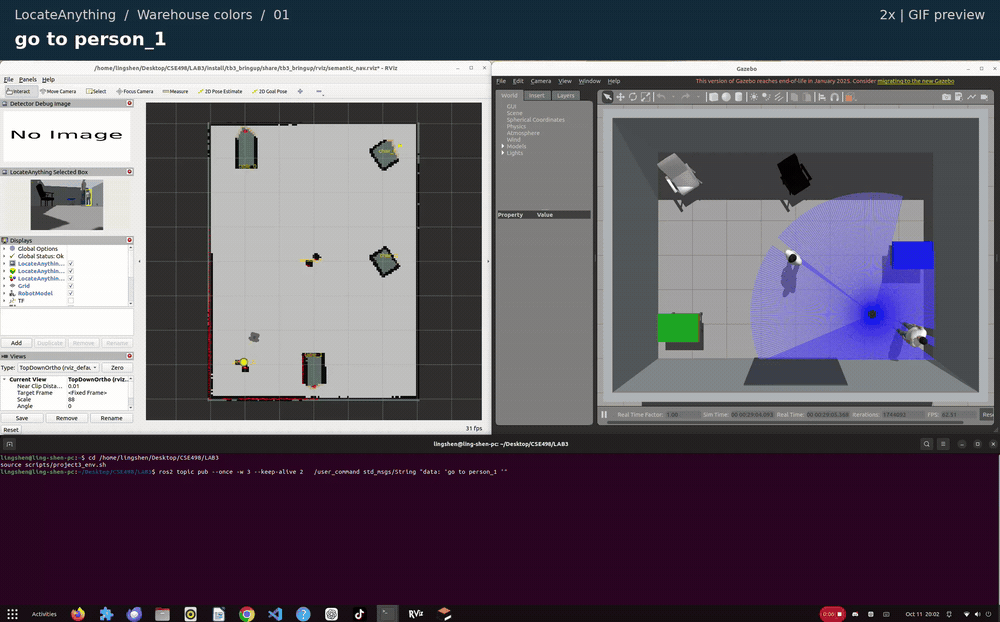

`go to person_1` → **`person_1`**.

The robot is already near this person, so it barely moves.

[Watch the original-speed MP4 (8.8 s)](colors-01-person-id.mp4)

### 2. Go to a chair by ID

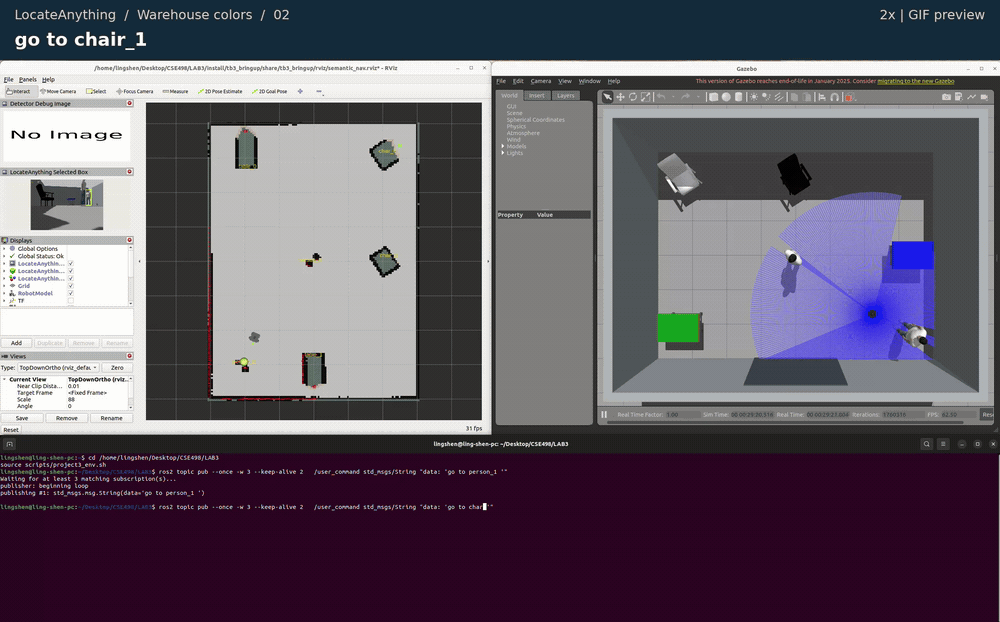

`go to chair_1` → **`chair_1`**.

[Watch the original-speed MP4 (31.3 s)](colors-02-chair-id.mp4)

### 3. Find a white object to sit on

`go to the white object that i can sit on` → **`chair_0`**.

[Watch the original-speed MP4 (22.6 s)](colors-03-white-seat.mp4)

### 4. Find the blue table

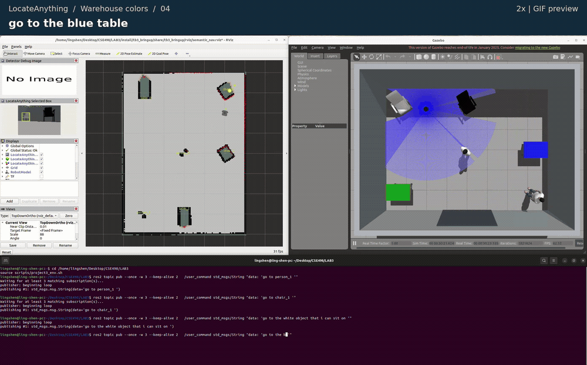

`go to the blue table` → **`table_1`**.

[Watch the original-speed MP4 (35.0 s)](colors-04-blue-table.mp4)

### 5. Find the green object

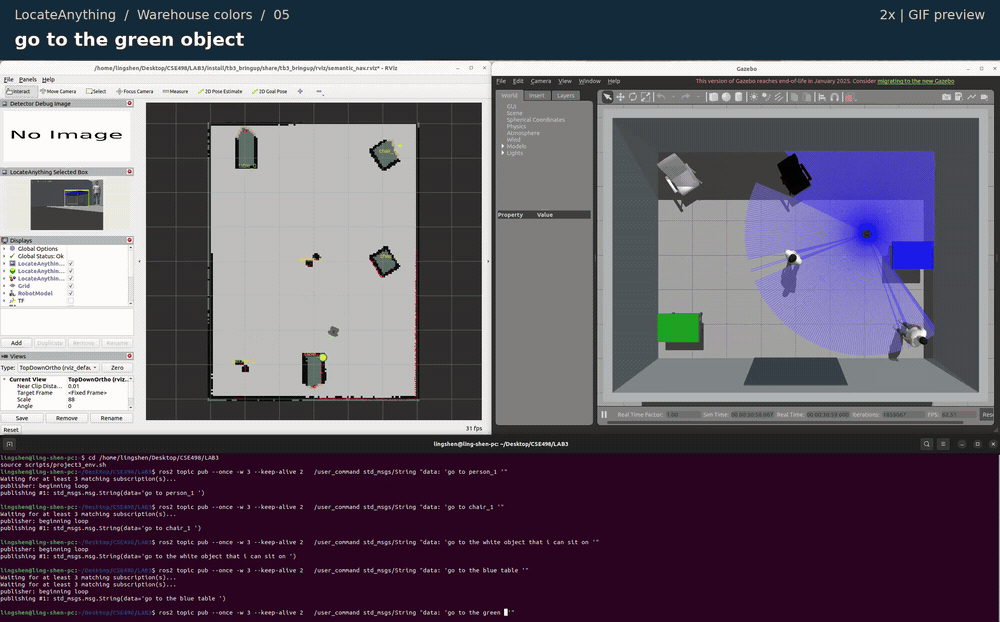

`go to the green object` → **`table_0`**.

[Watch the original-speed MP4 (34.8 s)](colors-05-green-object.mp4)

### 6. Find a person

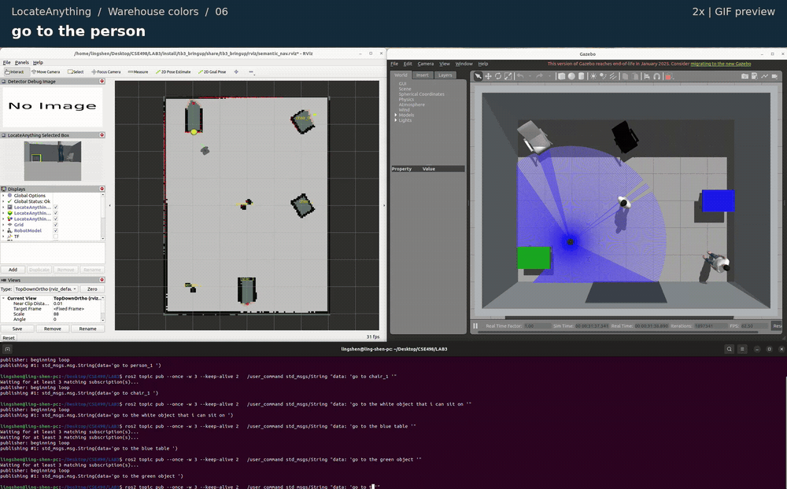

`go to the person` → **`person_1`**.

[Watch the original-speed MP4 (31.6 s)](colors-06-person.mp4)

## Warehouse objects

### 1. Go to a fire extinguisher by ID

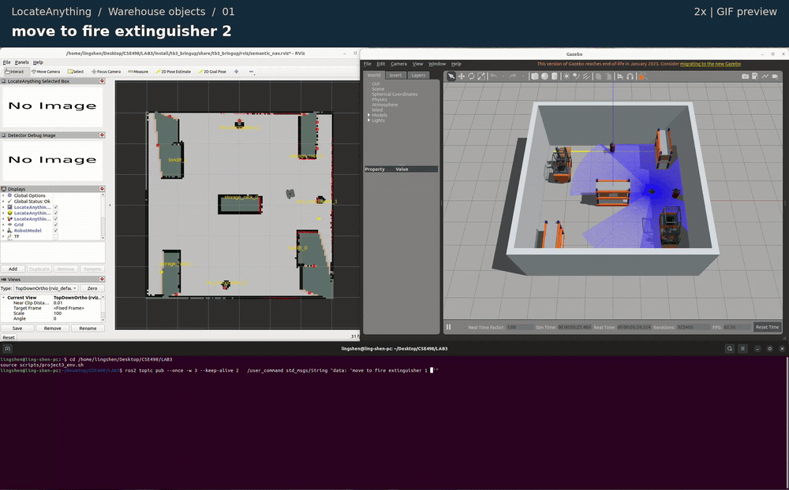

`move to fire extinguisher 2` → **`fire_extinguisher_2`**.

[Watch the original-speed MP4 (19.7 s)](objects-01-extinguisher-id.mp4)

### 2. Go to a storage rack by ID

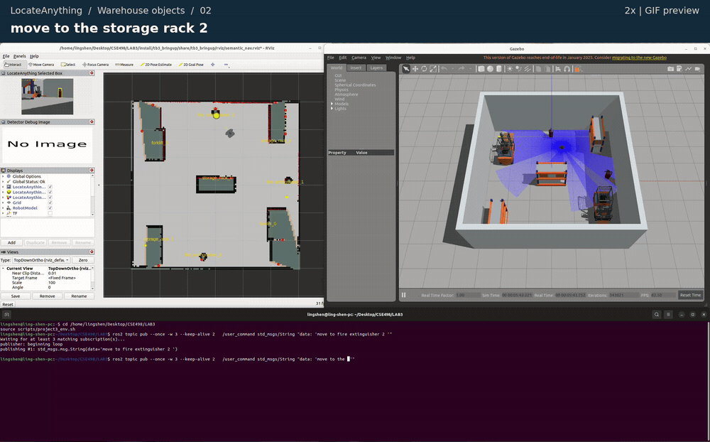

`move to the storage rack 2` → **`storage_rack_2`**.

[Watch the original-speed MP4 (17.9 s)](objects-02-rack-id.mp4)

### 3. Go to a forklift by ID

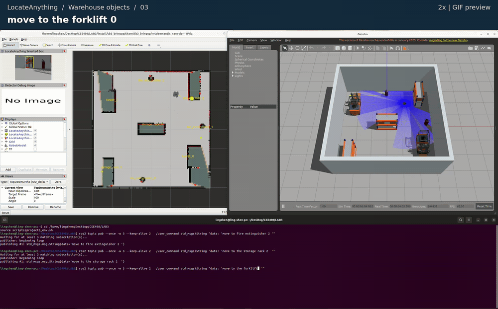

`move to the forklift 0` → **`forklift_0`**.

[Watch the original-speed MP4 (23.7 s)](objects-03-forklift-id.mp4)

### 4. Find something that puts out fire

`move to the object that can put out fire` → **`fire_extinguisher_1`**.

[Watch the original-speed MP4 (17.5 s)](objects-04-put-out-fire.mp4)

### 5. Find something that lifts things

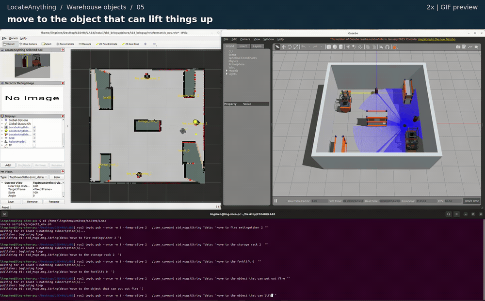

`move to the object that can lift things up` → **`forklift_0`**.

[Watch the original-speed MP4 (21.7 s)](objects-05-lift-things.mp4)

### 6. Cargo query: selected a forklift

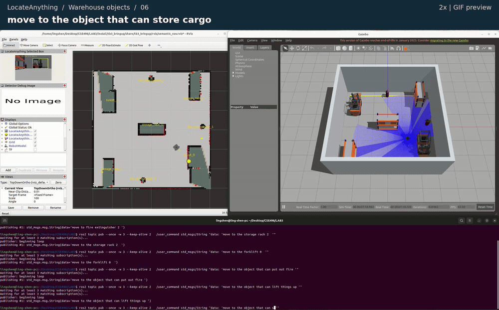

`move to the object that can store cargo` → **`forklift_0`**.

**Mismatch:** this wording selected `forklift_0`. The robot reached the
selected forklift; this clip does not show successful storage-rack selection.

[Watch the original-speed MP4 (11.8 s)](objects-06-store-cargo.mp4)

### 7. Go to another forklift

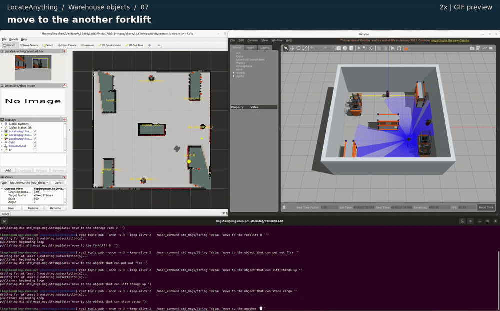

`move to the another forklift` → **`forklift_1`**.

Selects a different confirmed forklift from the previous target in memory.

[Watch the original-speed MP4 (33.3 s)](objects-07-another-forklift.mp4)

### 8. Go to a fire extinguisher

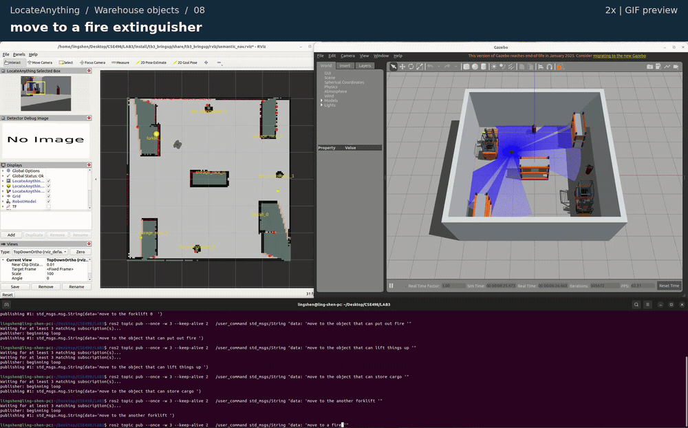

`move to a fire extinguisher` → **`fire_extinguisher_0`**.

[Watch the original-speed MP4 (29.2 s)](objects-08-a-fire-extinguisher.mp4)

### 9. Go to the farthest storage rack

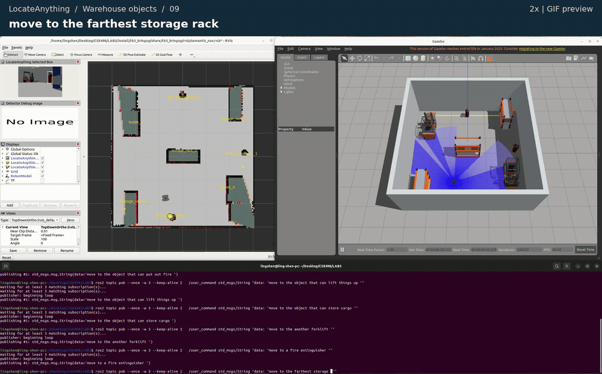

`move to the farthest storage rack` → **`storage_rack_2`**.

“Farthest” uses straight-line distance to the confirmed storage racks in
the current memory, rather than navigation-path length.

[Watch the original-speed MP4 (29.6 s)](objects-09-farthest-rack.mp4)

## Recording details

The source recordings are kept outside Git. [Clip metadata](clips.json) records
their filenames and SHA-256 hashes, the cut positions, and the selected IDs and
Nav2 results from the matching ROS logs. It also documents the timing reference
and the video transformations. These are recorded demonstrations, not a controlled
accuracy evaluation.
