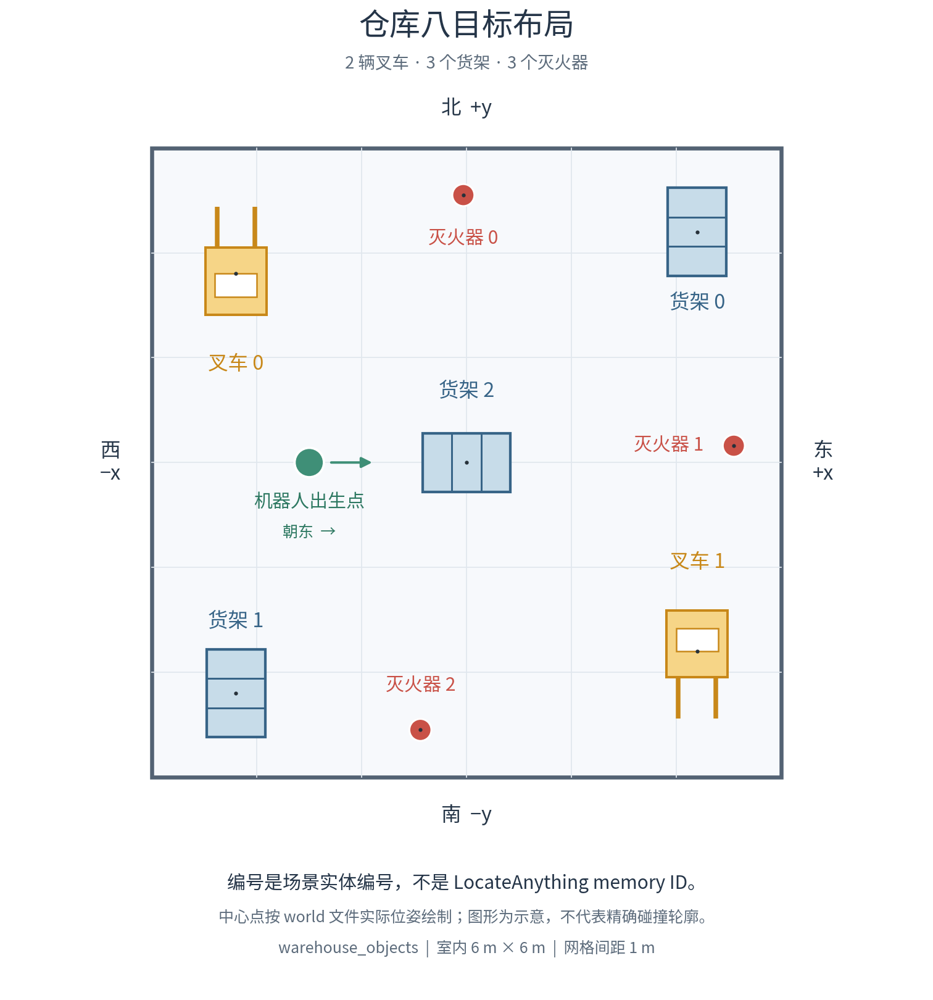

# 两个 LocateAnything 仓库例子

只需要两个终端。终端 A 启动整套程序，终端 B 发导航指令。LocateAnything 从 RGB 图像识别物体、建立视觉记忆，再根据指令找目标；物体坐标由对齐深度图、相机参数和 TF 计算。二维激光仍负责 SLAM 建图和 Nav2 避障。这个仓库只提供 LocateAnything 链路，从首次发现物体、确认记忆到按指令选目标，均由 LocateAnything 完成。

当前 demo 默认 `rgbd_camera:=true localization_mode:=depth`。RGB 与深度来自同一个 Gazebo 相机，使用同一时刻和光学坐标系；深度是传感器测量，不是 LocateAnything 猜出的距离。

[PDF 报告](../report/report.pdf)描述的是此前 RGB＋二维激光实现；当前架构和记忆参数以本指南及 README 为准。

先按 [README](../README.md) 编译。**两个终端都先执行：**

```bash
cd ~/project3a
source scripts/project3_env.sh
```

## 终端 A：选一个场景启动

8 个物体：2 辆叉车、3 个灭火器、3 个货架：

```bash
ros2 launch tb3_bringup locateanything_demo.launch.py scenario:=warehouse_objects
```

或者，两个人、绿/蓝桌子、白/黑椅子：

```bash
ros2 launch tb3_bringup locateanything_demo.launch.py scenario:=warehouse_colors
```

10 月 10 日检查发现：这台机器加载的 NVIDIA 驱动是 `595.91.07`，磁盘上的 CUDA/NVML 库是 `595.99.02`；`nvidia-smi` 报驱动与库版本不匹配，系统提示需要重启。请先保存工作并重启电脑以加载已更新的驱动，再确认 `nvidia-smi` 正常。若只是 `GLXCreateContext BadValue` 图形错误，可用以下环境变量让 Gazebo/RViz 使用软件 OpenGL：

```bash
LIBGL_ALWAYS_SOFTWARE=true __GLX_VENDOR_LIBRARY_NAME=mesa GALLIUM_DRIVER=llvmpipe \
ros2 launch tb3_bringup locateanything_demo.launch.py scenario:=warehouse_objects
```

这个前缀只改变图形渲染，不能修复 CUDA 或驱动与库的版本不匹配。LocateAnything 仍需要正常工作的 CUDA，不能把软件渲染当成整个 pipeline 已恢复的依据。

所有内置场景现在默认使用**随机安全出生点和朝向**，不再固定从同一角落开始。启动器根据房间墙壁、物体碰撞几何以及“机器人碰撞半径 + 0.15 米余量”检查位置；这些场景几何仅用于放置机器人，不会输入感知或 Memory。

每次默认启动都会生成新 seed，终端 A 会打印 seed、出生坐标/朝向和可直接复制的复现参数。想重复同一随机选择，可在命令末尾加 `spawn_seed:=498`，前提是场景几何不变。指定固定位置时必须同时给 `x_pose` 和 `y_pose`，若要固定朝向再给弧度单位的 `yaw_pose`；固定位置也必须通过相同碰撞检查，不安全就报错。

共享的 Nav2 使用单一 RPP 控制器完成起始转向、路径跟随和终点朝向调整，避免两个控制器在弯曲路径上反复给出相反的转向。配置前进速度上限为 0.22 m/s，原地转速为 0.6 rad/s；转弯、接近障碍物和目标时会减速，并保留碰撞预测检查。启动器只生成临时合并参数文件，不改系统安装的 Nav2 默认参数。

SLAM 使用继承自系统的同步建图配置，平移更新阈值改为 0.10 m、转角阈值改为 0.10 rad、地图发布间隔改为 1 秒。这样到达较近的探索目标后也能及时更新地图，避免原来的 0.50 m 平移阈值让建图和探索互相等待。NavFn 避开代价地图中的未知格，探索目标仍须有已知可通行的连接路径。

默认 `slam_profile:=simulation_world_odom` 保留局部激光匹配，关闭回环修正。课程 Gazebo 插件原本就提供基于 world 的低漂移里程计；仓库重复结构曾触发错误回环，使地图跳动。这项配置没有读取物体真实坐标或预制地图。`slam_profile:=default` 保留系统原有回环设置，适合另行测试其他里程计条件，不能把当前仿真结果直接套到真实编码器里程计上。

发送导航指令后，adapter 会先检查当前全局代价地图。它优先选距离测得目标点 0.5 米的停车位置；若该点在障碍物内或太靠近障碍物，可在显式的 `max_approach_distance:=1.0` 米范围内选择连通、已知且 cost≤60 的格中心，并朝向目标。机器人位置使用缓存中最新的 TF，不阻塞等待恰好等于当前时刻的样本；最新样本若位于未来，只能使用缓存已有数据插值得到当前变换。TF 的 0.75 秒有效期、时钟回退和搜索耗时检查保持不变，缺少新鲜地图或 TF 时仍不发布目标。NavFn 的近似终点容差为 0.05 米，避免悄悄停在原目标半米外。这里的距离针对测得的物体点，不等于机器人外壳到完整物体表面的净空。

两个模式都保留 `/cmd_vel` 接口。仿真中的 `velocity_relay` 以 20 Hz 将最新速度指令原样转发到 `/tb3_drive/cmd_vel`，由这一个节点向机器人驱动发布。连续 0.5 秒没有新指令就发送零速度；仿真时钟回退会清除旧指令，正常退出前也会发送零速度。超时按真实经过时间计算，暂停仿真时钟也有效。Nav2 的规划和碰撞检查继续生效，无需改变终端里的用户指令。

一次只运行一个。启动器包括 Gazebo、SLAM、Nav2、RViz、LocateAnything 和探索节点。物体场景的两辆叉车分布在两个角，三个货架分布在另外两个角和中央，三个灭火器分布在三条不同边。

LocateAnything 的三个场景默认 `startup_scan:=false`：Gazebo、SLAM/Nav2 和后端同时启动，取消原来第 10 秒、第 20 秒分批启动的安排，也不再先等待 12 秒或强制原地转一圈。SLAM 收到传感器数据后就开始建图；探索在 Nav2 已激活、TF 和新鲜代价地图可用、存在安全可达的探索目标时开始，不等待模型加载或物体 Memory 完整。程序启动和传感器就绪仍需要时间，因此不保证输入启动命令后零秒就移动。

如需恢复以前的启动扫描，加 `startup_scan:=true`：三个 demo 场景会先等待 12 秒，连续转四次 +90°，每次转完暂停 2 秒；转向按里程计实测角度结束，不保证固定多少秒转完。使用 `startup_scan:=true warmup_full_rotation:=false` 则扫描约 ±70°。扫描本身不保证看到或确认所有物体，应继续探索取得不同位置的观察。

探索最多使用两次启动辅助目标，之后由正常的 frontier 导航接管；每个探索目标在连续 20 秒没有测得进展或累计达到 180 秒时取消，失败位置附近的占据地图未变化时不重试。这些是单个探索目标的限制，不表示 180 秒内一定看完整个房间。

探索目标从真实的 frontier 边界格及其内侧选取：沿已知空闲格按上下左右四个方向搜索，退让路径最多 0.5 米，终点必须与机器人连通且 cost≤60。先选满足安全条件的最小退让距离，再以接近边界簇中心作为排序依据，因此 U 形或环形边界的中心不在边界附近时也能选点。终点朝向所选真实边界旁的未知格，让前向相机朝向待探索区域。程序每秒用当前代价地图和机器人 TF 重新评估安全性，即使 SLAM 地图内容未变；安全输入过期时不发布新的可用目标。

机器人当前位置持续处于碰撞区，或者连续两次导航失败且没有实际平移，也会报告 `robot_blocked`，不会把卡住当成“扫描完成”。

叉车的低叉齿上放了可见的木托盘，外观与碰撞几何一致，让真实二维激光能探测到这部分障碍，避免机器人爬上低于激光平面的叉齿。IMU 检测到机体倾斜超过 15° 且持续 0.5 秒时，探索会以 `robot_blocked` 停止；需排除物理卡住、摆正机器人后重启节点，不会继续把其他目的地误标为不可达。



图中的出生点是旧固定位置示意；当前实际随机出生点以启动日志为准。

默认行为是**先探索建库，收到目标指令后暂停探索，到达后停住等待下一条指令**。指令失败后也保持停止。启动器的 `auto_resume_exploration` 默认是 `false`；若要恢复以前每次完成后继续探索的行为，在启动命令末尾加 `auto_resume_exploration:=true`。`explore:=false` 是另一个选项，只关闭启动扫描和探索，不关闭目标导航或视觉记忆。但随机起点可能背对目标，通常应保留默认探索；红蓝椅子 `scenario:=chairs` 也一样，旧录像里一开始就看到两把椅子使用的是固定起点。

发送目标指令前，等 RViz 出现地图、Nav2 显示 `Managed nodes are active`，以及 LocateAnything 出现 `ready` 和 `memory_updated`，再确认想去的目标已在 Memory 中。**模型 ready 不等于目标已经入库，机器人开始探索也不表示物体已经确认。** 默认没有强制原地扫描；若仍不移动，应查看当前就绪条件或探索状态。

切换场景时，在终端 A 按 `Ctrl+C`，等启动器和子进程全部退出，再启动另一个场景。每次重新启动会重建地图和这一轮记忆，不要在同一套运行进程内调用 `reset_simulation`。

## 终端 B：先看记忆，再发指令

```bash
ros2 topic echo --once /locateanything/memory --qos-durability transient_local
```

深度模式把记忆分成两部分：`pending_landmarks` 是待确认的 `candidate_N`，`landmarks` 才是已确认类别的正式 ID。`object_id` 是编号，`label` 是类别，`x/y` 是估计位置，`view_ids` 是保留的观察画面。选择目标前检查 `confirmed: true`、`conflicted: false` 和非空 `view_ids`；待确认或冲突记录不能作为用户指令的最终导航目标。RViz 的 **LocateAnything Memory** 只显示已确认且无冲突的编号。

机器人停止后，Memory 和编号标记仍每秒按当前 TF 更新一次位置，一次发布共用同一个变换，不会因此新增图像或类别票。消息中的 `epoch`、`publish_stamp_ns` 和 `map_projection` 记录当前会话、发布时间和实际使用的投影 TF；缺少有效变换时会明确标记无效。

确认要求机器人从至少两个相距 0.25 米的位置观察到同一物体，并且领先类别至少有 2 票、比第二名多至少 2 票。例如 2:0 和 3:1 可以确认，2:1 还不够。原地转头、重复帧和过近位置不增加独立票，删掉旧图也不会自动确认。`evidence.label_votes` 和 `evidence.independent_viewpoints` 可以查看依据。**即使手动开启启动扫描，原地转一圈也不等于确认完成，应继续探索取得移动后的视角。** 这些阈值是当前实现规则，无需另外输入参数。

物体场景有 8 个目标，颜色场景有 6 个目标。地图完整或出现 `EXPLORATION COMPLETE`，都不证明这些物体已全部识别和确认。仍要结合位置和图像核对，不能只凭条目数等于场景物体数判断正确。

同一份 JSON 的 `catalog_pending` 是排队和正在执行的 inventory 任务数量，不是待确认物体数量。`catalog_idle: true` 且 `catalog_pending: 0` 只表示这些任务已经结束，**不表示全部物体已经识别、确认，也不保证识别正确**。新的视角仍可能带来新目标。

建库每次只接纳一张尚未处理的画面，等推理结束后再采集下一张，避免模型忙时新画面把未完成的旧画面挤出 32 张缓存。用户查询在当前推理结束后优先处理，也遵守这个采集限制；0.25 秒检查一次不代表每秒完成 4 次模型推理。

普通 frontier 没有可用的下一目标时，程序可以为已有的待确认物体补一个观察位置。它检查 16 个方向，每个方向考虑距物体 1、1.5、2 米的位置，并根据已测物体大小再搜索至多一个距离。相机标定、相机安装位置和当前 Nav2 停车容差用于检查水平构图，避免观察点太近导致已知物体范围超出画面。缺少这些参数时不生成观察目标；这个检查不能保证未见部分或垂直方向完整入镜。候选仍须可经已知空闲区域到达、终点 cost≤60，并保留失败区域等安全过滤。补观察可以返回普通 frontier 已探索的区域，不会仅因该处以前拍过其他物体就排除它。不读取场景实体名或真实坐标。

如果 SLAM 在机器人脚下留了未知小格，起点连通检查可在当前 Nav2 机器人轮廓内部临时连接到已知空闲区域。参与连接的整个地图格必须包含在轮廓内，且覆盖它的所有代价地图格必须在 0–98 的可通行范围；1–98 是膨胀代价，不能因其非零就拒绝起点。未知代价、99（内切碰撞区）、100（障碍物）、SLAM 占用格和轮廓外的未知格仍禁止通过。程序使用轮廓自身时间戳的 TF 恢复形状，再按当前机器人姿态投影；证据缺失或过期时拒绝连接。普通探索与补观察使用一致规则，不修改 SLAM 地图，也不会把未知格当成导航终点；终点 cost≤60 及 Nav2 规划、碰撞检查仍生效。

补观察的计划位置须距本任务的原始证据位置至少 **0.25 米＋当前 Nav2 的 XY 到达容差＋0.05 米余量**，当前容差为 0.25 米时即 0.55 米。实际成功到达后，在固定采集窗口内至多专门保存一张新的 RGB-D 图，不拿全局旧图代替。这个专用采集可以绕过普通的重复视图过滤，仍须满足同步传感器、单张 inventory 接纳、深度定位等检查。真实观测位置之间至少 0.25 米的类别独立票规则不变；到达或重复处理旧图都不能直接加票、确认物体。

普通待确认任务优先检查清晰地图视线；多假设提示先考虑未尝试组，并在同一层内优先选择清晰视线。每个任务最多实际派发一次标为 `unknown_3d_visibility` 的观察：二维激光地图不能完全判断相机在不同高度能否看见目标。这不表示目标一定可见，也不放宽通行、构图或新检测的确认条件；它只在原有预算内多给一次观察机会，取消后不退还次数。

合法检测框因多组深度表面而无法定位时，程序还会在 `/locateanything/memory` 的 `observation_hints` 中保留“需要换角度观察”的记录。它保存全部实测表面假设及原始视角，**不是物体 ID、目标坐标或类别票**。观察节点可以一次针对其中一组实测表面安排视角，仍保留全部假设；这不表示已确定哪个表面属于目标，也不声称其他表面同时入镜。后续明确的检测仍须经过正常的定位和 Memory 确认。重新看见已知背景物体不能直接消除这条记录。同一次地图会话最多保存 32 条提示，按 Memory 的时限过期；重复证据沿用原任务，不重置次数。

规划还会保留最多 32 个未实际尝试的旧观察位置，以 odom 坐标保存，并按当前地图重新检查朝向和安全性。圆环位置与旧位置都无解时，再检查最多 64 个附近可达的地图格中心，总共最多 160 个候选；有限采样仍可能漏掉可行位置。视角独立性相对于原始证据位置判断，而不是要求机器人从当前位置再走固定距离，因为探索可能已经把它带到了合适的位置附近。

同一画面中的合法深度表面被赋予不同类别时，还会保存 `class_ambiguity` 提示，记录候选类别及真实表面，不选择类别、不增加 Memory 票数。任何成员定位失败或水平裁切时，整组不生成这类提示。后续清楚的新画面仍须满足原有独立视角确认标准。

调度先考虑具有有效位置的待确认物体，再考虑提示；已提出或正在执行的观察不会被抢占。一个提示内优先调查尚未实际尝试的表面，同一层内先选清晰视线，再按原相机实测距离排序。每组最多检查原有的 160 个候选，至多 8 组；只是选择去哪里看，不是选择哪个表面就是目标。`focus_dispatched_by_task` 可查看实际尝试的组号。

待确认物体、深度提示和类别提示共用补观察预算：**每个任务 2 次、整轮 8 次**。从首次实际派发起的 **120 秒仿真时间**是导航窗口，过期后不再派发新目标。每次实际成功到达仍有固定 **5 秒**供采集，随后至多再等 **30 秒仿真时间**，让已经接纳的 inventory 工作收尾；这段等待不会重置预算或允许继续派发。普通 frontier 优先，收到用户目标指令后暂停补观察。没有安全新视角、达到预算或证据仍不明确时，候选会继续保持待确认，不会自动转成正式 ID；这些限制不保证全场识别完成。

可另查补观察状态：

```bash
ros2 topic echo --once /locateanything/observation_status --qos-durability transient_local
```

`observing` 表示正在执行观察目标，`settling` 表示到达后的停留；`budget_exhausted` / `track_budgets_exhausted` 表示后续次数或时间受限。`detail` 会说明等待模型任务或找不到安全视角等原因，`total_dispatched` 和 `attempts` 记录已派发次数。`pending_tracks_total` 统计待确认物体，`conflicted_tracks_total` 统计类别冲突物体，`uncertain_dispatched_by_task` 记录不确定可见性的尝试次数。`observation_hints_unresolved`、`observation_hints_expired`、`observation_hints_exhausted` 分别统计未解决、已过期和用完次数的深度或类别提示。不同的实测分组仍可能产生不同任务，所以每任务 2 次不等于每个物理物体必定只试 2 次；整轮上限仍生效。`incomplete` 包括未解决或过期的提示及类别冲突；`no_pending_tracks` 或 `incomplete: false` 仍无法证明不存在还没看到的物体。

程序不会只读取框中心的一个深度像素，因为中心可能落在遮挡物上，也可能穿过货架空洞落到墙上。它检查目标框及周围的实测深度表面，排除地面、背景和明显延伸到框外的表面；剩余表面仍无法确定归属时，拒绝这次观察，等待更清楚的视角。不同类别的框高度重合或互相包含时，默认拒绝；只有两个框各自通过深度定位，实测 XY 支撑范围至少相隔 0.35 米，且测得深度至少相差 0.5 米，才允许作为前后两个物体。例如货架空隙后方的灭火器可以满足条件，给同一叉车重复贴两个类别则不能。任何一个框缺少可靠深度，都不允许这个例外。这些检查并不保证模型类别正确或每个视角都能定位。

每次采集还要求同步的 IMU 姿态，机体倾斜超过 15° 时停止新增观察。深度模式缺少对齐深度时会等待或失败，不会自动改用激光。若需要旧 LocateAnything 激光定位路径，可加 `localization_mode:=laser rgbd_camera:=false`；它仍要求物体与激光扫描平面相交。

### 叉车、灭火器、货架

可以发送自然语言描述，也可以指定编号。让 LocateAnything 找到匹配的叉车，再从它返回的有效目标中选一辆：

```bash
ros2 topic pub --once /user_command std_msgs/String "data: 'go to a random forklift'"
```

`go to any forklift`、`go to a forklift` 和 `go to a random red chair` 都先交给 LocateAnything，保留描述里的全部词语，包括 `random`、`red` 等限定。非空间关系的描述以 `any/random/a/an` 开头时，允许从模型匹配出的有效目标中任选一个；按物体 ID 去重后随机选择，不是只认类别关键词就从整个 Memory 抽签。模型可能只返回一个目标，因此不能说是在房间所有物体之间等概率抽取。重复发送也可能选中同一个，“随机”不表示“另一辆”。

其他非空间描述，例如 `go to the forklift` 或 `go to the object that can store cargo`，也允许模型返回多个匹配。系统默认从模型实际匹配到、已确认且无冲突的有效 ID 中，选择离机器人当前位置最近的一个。这里比较的是 XY 直线距离，物体坐标使用同一个当前 `map <- odom` TF 转换；不是从整个 Memory 任选最近物体，也不是比较导航路径长度。左右、角落、邻近等关系仍使用完整场景图；简单的 `another` 和远近指令按下节规则处理。模型仍可能把不符合用途的物体判为匹配，所以机器人到达不等于语义判断一定正确。

如果要指定编号，先查本轮 memory 并在 RViz 核对位置，然后发送：

```bash
ros2 topic pub --once /user_command std_msgs/String "data: 'go to forklift_1'"
```

默认启用编号查表（节点参数 `enable_explicit_id_lookup=true`），`go to a forklift_1` 也可以，冠词 `a/an/the` 均接受。明确编号直接查表；简单的 `another` 和远近指令比较已确认记忆；其他自然语言描述由 LocateAnything 判断。这些路径都使用 LocateAnything 建立的 Memory，不需要仿真器真实坐标；选中后仍检查证据、定位和 Nav2 条件，不保证目标一定可达。

| 类别 | 指定编号 |
|---|---|
| 叉车 | `go to forklift_N` |
| 灭火器 | `go to fire_extinguisher_N` |
| 货架 | `go to storage_rack_N` |

把 `N` 替换为当前记忆中的正式编号，不要原样输入 `N`，也不要向 `candidate_N` 发导航指令。深度模式按类别确认顺序分配编号，既不等于 Gazebo 的实体名，也不固定代表某个角或方位。`Move to the forklift.` 这类泛指类别的指令可能匹配多个候选而被拒绝；不能靠它指定两辆叉车中的某一辆。用户指令和编号仍使用 **storage rack / storage_rack_N**。模型 inventory 内部采用更明确的 `forklift truck`、`storage shelving unit` 名称，返回后会转回原类别，不改变用户命令。

### 两张桌子、两把椅子、两个人

第一条可直接输入：

```bash
ros2 topic pub --once /user_command std_msgs/String "data: 'Move to the green table.'"
```

之后仍用同一个 `ros2 topic pub` 格式，每次只换引号里的句子：

| 顺序 | 指令内容 |
|---|---|
| 1 | `Move to the green table.` |
| 2 | `Move to the blue table.` |
| 3 | `Move to the white chair.` |
| 4 | `Move to the black chair.` |
| 5 | `go to person_1`，前提是本轮记忆里确实有这个 ID |
| 6 | `go to person_0`，前提是本轮记忆里确实有这个 ID |

两个人的 ID 要先看当前已确认的记忆，第 5、6 条按编号查找。上表沿用之前 RGB＋二维激光实测时的发送顺序；当前深度模式按确认顺序分配编号，重启后 `person_0` 不保证仍是同一个人，也不固定代表左边的人。同样，`table_0` 不自动等于绿色桌子。

**每条指令之间都等上一条完成：** 默认设置下，看到 `TARGET_REACHED` 或 `TARGET_FAILED` 就可以发下一条，不需要等 `exploration resumed`。机器人会保持停止，直到收到下一条指令。`SEMANTIC_QUERYING` 或 `SEMANTIC_NAV` 表示还在处理。需要单独看状态时，在终端 B 执行：

```bash
ros2 topic echo /coordinator_node/status
```

按 `Ctrl+C` 只停止这个状态查看，再输入下一条导航指令。

### another 与远近指令

先成功到达一把椅子，再发送 `go to another chair`，会排除**上次成功到达**的椅子。`go to the other chair` 同义；两个人也可用 `go to another person`。仅选中目标、导航失败或取消不会更新参照。没有同类别的上次到达记录、记录已过期，或重启／仿真时钟回退后，会明确报错，需先成功到达一个目标。剩余多个合格目标时选最近的一个。

`go to the farther person` / `go to the nearest chair` 使用**机器人本次查询的位置**与同类已确认物体的 XY 直线距离。`far/farther/farthest/further/furthest` 选最远，`near/nearer/nearest/closer/closest` 选最近；不是画面大小或导航路径长度比较。至少需要两个同类目标，所有相关候选都须已确认、无冲突且有有效历史定位证据。前两名距离差不超过 0.15 米时拒绝比较；节点参数为 `relation_distance_margin_m`。比较范围仅为当前视觉记忆，不保证覆盖尚未发现的物体。

这些规则目前支持“关系词＋裸类别”，例如 `another chair`、`farther person`、`nearest storage rack`。带颜色、用途或其他参照物的组合，如 `another red chair`、`farther person from the table`，会明确提示尚不支持，避免丢掉修饰词后选错。已确认类别仍来自 LocateAnything 观察；这类简单查询不再让模型根据旧照片重新猜远近或“另一个”。

发送示例（先等上一条结束）：

```bash
ros2 topic pub --once -w 3 --keep-alive 2 /user_command std_msgs/String "data: 'go to another chair'"
```

`-w 3` 等待当前 demo 的三个订阅者，`--keep-alive 2` 给单次消息留出传输时间。`/semantic_navigation/reached_target` 保存协调器确认成功到达的原始选择消息；感知节点按本轮选择标记校验，拒绝旧会话和迟到的旧结果。`selected` 日志中的 `relation_candidate_ids`、`candidate_distances_m`、`selection_robot_map`、`excluded_object_id` 记录实际决策依据。

`corner` 现在保留完整场景上下文，`left chair` / `right person` 保留明确目标类别，已知桌子框不能充当椅子。这些防护不等于已解决角落、左右及邻近关系的视觉理解。当前修改通过受控回调与几何回归测试；需重启 demo 后另做真实模型与导航验证。

## 为什么离开当前视野后还能找到

探索时，程序每 0.25 秒检查是否有值得保存的新视角，转角阈值为 15°，同时检查移动距离。保存画面与模型推理分开进行，这不是每秒运行四次模型。每张保留的图先发一次原生多类别 inventory 请求，一起寻找配置中的类别；返回框按模型实际输出的类别配对。配置中的某类没有返回框时，就用该类的标准名称在同一张图上单独补查一次，对所有类别采用同一规则。这包括联合回答为 `None` 或没有提到该类的情况。每张图最多执行一次联合请求加每类一次补查，不再循环重试。原始回答、补查回答和耗时都保留，所有框合并后一起接受几何检查；补查不保证找到目标，也不能直接确认类别。某类的 `None` 只适用于该类，未提到某类不等于确认它不存在。

跨视角关联会参考对齐深度提供的实测物体表面点，并把这些证据保存在 odom 坐标系中，帮助判断换个角度看到的是否仍是同一个物体。同一画面里分开的两个物体不会仅因为位置接近就合并。深度模式中，一个已确认目标偶尔出现一次其他类别时，先保留证据供核对；另一类别需要两个独立位置的支持，才可能标为 `conflicted`。若原类别曾有未触及图像边缘的完整框支持，截断近景的其他类别票只保留供核对，不能单独触发冲突；同样完整的竞争证据仍可触发冲突。首次确认仍允许两次独立的截断观察，例如顶部超出画面的高货架。框完整不代表类别一定正确。已有冲突保持原编号和类别并禁止导航，不会靠后续投票或淘汰旧图自动消失。

可选的旧激光模式保留此前规则：一次有效观察可以建立正式 ID，出现不同已知类别就标为冲突。

深度能区分前后表面，但不能独自证明它们属于哪个语义类别；相互遮挡、细框架和模型误识别仍可能导致拒绝或冲突。冲突目标必须按不确定记录处理，不能把条目数等于 8 当成完成验证。

默认最多保留 32 个视角、30 分钟的证据，优先保留某个物体仅剩的观察图、各类别的独立视角及完整框来源。类别票仍从实际保留的图片计算，不会为已经丢弃的图虚构历史票；32 张容量也不能保证保住所有证据。失去全部图像证据的 ID 会从记忆中删除。这份记忆只属于当前启动的地图会话，重启或仿真时钟回退会清空。保留这些证据不代表物体去重和类别判断一定正确，定位仍要求物体静止，并且保留画面中的深度证据可用。

查询颜色、外观或用途等非空间描述时，系统把已确认物体的裁剪图放在一张 gallery 中，让 LocateAnything 一起比较。选中后回到该物体的**原始相机画面和框**，用当时保存的深度、相机参数和 TF 计算物体在当前地图中的位置。gallery 本身不用来算物理坐标。左右等空间关系使用保留的完整场景图。

所有非空间描述，包括 `go to the object that can store cargo` 和 `go to the storage rack`，都先用已确认、无冲突且有可用图像证据的物体组成 gallery，再让 LocateAnything 匹配完整描述。同类或其他类别的待确认、冲突、无可用图像记录不会阻断这次模型调用；这些记录只是从此次 gallery 中排除，不会因此被删除或自动确认，也不能被选中。模型返回的有效匹配按 ID 去重；普通非空间描述默认选择最近的有效匹配，“任意一个”则随机选择；没有匹配仍会失败。匹配范围是当前 Memory 中的可用已知目标，不能据此断言整个房间已经识别完整。

深度模式的空间关系查询仍检查相关类别的待确认与冲突记录；存在这些记录时拒绝选择。指令没有明确类别时检查全部记录；明确类别的查询不因无关类别的待确认记录而被阻断。简单的 `another`、最近／最远指令使用上节所述的记忆比较规则，也拒绝相关类别的待确认和冲突记录。编号查询检查指定 ID 本身，所有最终选中的身份仍须有效。`enable_explicit_id_lookup` 是节点启动参数，不是 demo 的 launch 参数。

因此，可以在**同一次启动中**依次去绿桌、蓝桌、白椅、黑椅，中途不用复位。前提是目标已经确认、有可用证据且模型能给出可靠匹配，选中后还须通过定位与导航检查。RViz 的 **LocateAnything Selected Box** 展示被选中的原始观察画面，可能是历史图；实时画面看 `/camera/image_raw`。日志中的 `historical_view=true` 只说明图像早于本次命令，并不能单独证明目标现在不可见。

## 已完成的验证与可选检查

上文描述当前 r11 机制；下列历史记录不能证明 r11 已通过完整测试矩阵。

下面保留的数字均属于**此前 RGB＋二维激光版本**及其当时的出生点/场景设置，不能作为当前 RGB-D、随机安全出生点版本的通过证据。报告和历史结果没有随这次启动方式修改而重测。

2026-10-10 的[八目标 Memory 修复实测](../report/memory_repair_results.json)记录了此前版本的结果：从第一个探索导航目标到自然停止，较早运行为 554 秒，该次修复运行为 324 秒；探索结束时 8 个真实目标各有一条可用记录，没有重复或无图记录。但共同室内区域的已知地图面积从 31.7125 m² 降为 29.005 m²，路线及叉车托盘也有变化，因此不能宣称相同覆盖下提速，更不能把 `EXPLORATION COMPLETE` 理解为房间 100% 扫完。

同一会话中，`fire_extinguisher_2` → `storage_rack_1` 两条导航均到达，随后各观察到停止超过 11 秒，没有恢复探索；11 秒是测试观察时长，实际等待没有这个时限。第二条导航带来的新视角仍出现“前景货架挡住后方叉车”的定位歧义，中央货架被保留原 ID 并标为冲突：最终 **8 条记录、7 条可用、1 条待确认**。这证明错误覆盖和重复新增受到抑制，不代表 RGB＋二维激光的遮挡归属问题已经解决；也不代表全部 8 个目标的停车位置都已验证。

[仓库实测记录](../report/warehouse_results.json) 保留了之前两个独立场景的连续执行结果：

- `objects_v4`：旧三目标布局中，叉车 → 灭火器 → 货架，**3/3 通过**；不代表现在的八目标布局已验证。
- `colors_v3`：启动扫描记录了全部 6 个目标；绿桌 → 蓝桌 → 白椅 → 黑椅 → `person_1` → `person_0`，**6/6 通过**。桌子使用彩色桌面、四根灰色金属腿和可见下框架，外观与碰撞一致。

每组内部没有重置或重启。通过条件包括选对实体、定位误差 ≤0.5 m、最终距物体原点 ≤1.2 m、`TARGET_REACHED` 和恢复探索。[红蓝椅子实测](../report/visual_memory_results.json) 也记录了最终连续 **2/2** 通过。这些是具体运行结果，不是一般成功率基准，也不保证每次启动都立即看全所有物体。

这些 2/2、3/3、6/6 记录均来自改为“到达后停住”之前的自动恢复探索设置，不能用来证明新的等待行为已经通过实测。`auto_resume_exploration:=true` 可以恢复旧控制行为，但不会恢复旧三目标布局。
另一次[独立停住等待实测](../report/hold_results.json)也使用旧三目标布局，未重置地图或记忆，两条命令到达后各保持停止 11 秒，且第二条从 `TARGET_REACHED` 正常接收；这是控制行为测试，不是新的语义精度评估，也不代表八目标场景已通过验证。

记录同时保留了旧 `colors_v1` 的一次人物导航：目标选对，但 Nav2 超过 60 秒未到达；后续人物重试通过。最新六条连续通过不能证明所有局部规划卡顿都已解决。

平时只需上面的 `ros2 topic pub`。需要保存正式测量时，再查看 `python3 scripts/project3_check.py --help`；检查脚本会自己发送命令，`--truth` 仅供评估核对，不会把真实位置给 LocateAnything。不要为同一次检查重复手动发指令。

也可以确认记忆中没有 `person_99` 后发送 `go to person_99`，检查它是否失败且不发导航目标。自然语言描述一个不存在的物体时，模型仍可能误识别；有检测框或 Nav2 到达都不能单独证明语义正确。
